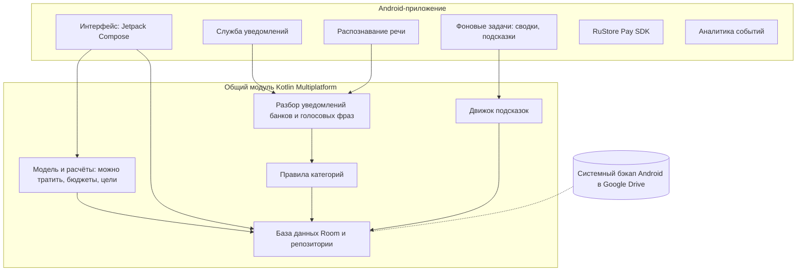

# Архитектура: Android MVP с заделом на iOS и Web

Документ сравнивает варианты стека, выбирает архитектуру и фиксирует технические решения. Требования (R1–R45) — в [документе требований](../plans/2026-11-10-2326-feat-android-mvp-plan.md), экраны — в [UX-спецификации](../design/2026-11-11-ux-spec.md).

**Обозначения:** ✅ подтверждено источником, ⚠️ подтверждённое ограничение, 🔍 гипотеза, проверить при реализации.

## 1. Проверка блокирующих рисков

Эти факты могли отменить главную функцию или монетизацию, поэтому проверены до выбора стека.

| Вопрос | Результат | Следствие |
|---|---|---|
| Разрешает ли Google Play читать уведомления других приложений | ✅ В правилах Google Play нет отдельного правила или декларации для доступа к уведомлениям. Действуют общие правила о пользовательских данных: заметное раскрытие в приложении и согласие до запроса, финансовые данные — «личные и чувствительные», не собирать лишнего | Автоматизация допустима. Экран доступа к уведомлениям в онбординге (R32) должен соответствовать требованиям раскрытия: что читаем, зачем, где хранится — до системного запроса |
| Работает ли биллинг Google Play для пользователей из РФ | ⚠️ Приостановлен с 10 марта 2022 года, платные приложения и покупки в РФ недоступны | Продавать подписку российским пользователям через Google Play нельзя. Встраивать в версию для Google Play чужую оплату правила Google Play запрещают |
| Биллинг RuStore | ⚠️ Старый BillingClient SDK перестал обрабатывать платежи с 1 августа 2026 года. ✅ Новый RuStore Pay SDK официально есть для Kotlin/Java, Flutter, React Native и других | Использовать только Pay SDK. Выбор стека этим не ограничен |
| Верификация разработчиков Android | ⚠️ С 30 сентября 2026 года действует в четырёх странах, для России запланирована на 2027 год. RuStore рекомендует заранее пройти верификацию в Android Developer Console и зарегистрировать имя пакета; это можно сделать без публикации в Google Play | Задача на подготовку к выпуску: верификация разработчика и регистрация пакета. Окончательные правила 2027 года не опубликованы — следить |
| Системный бэкап Android | 🔍 Шифрование копии ключом блокировки экрана (Android 9+), около 25 МБ на приложение, копия примерно раз в сутки | Проверить на устройстве в начале реализации. Важное следствие для шифрования базы — раздел 6 |

## 2. Что требования говорят о выборе стека

Пять требований определяют выбор сильнее остальных:

1. **Фоновая обработка уведомлений банков** (R5–R10, R41–R43). Уведомление приходит, когда приложение закрыто. Служба Android должна сама разобрать текст и записать операцию в базу, не поднимая интерфейс. Это нативный код Android при любом стеке; вопрос в том, на каком языке написаны разбор, правила категорий и доступ к базе.
2. **Логика — главная ценность и общая для всех платформ.** Расчёт «можно тратить» (R16), обнаружение регулярных платежей (R15), движок подсказок (R19–R24), разбор голосовой фразы (R3, R4) понадобятся на iOS и Web без изменений.
3. **Нативные возможности Android:** распознавание речи на устройстве (R3), системный бэкап (R29), виджеты, уведомления со сводками (R24), RuStore Pay.
4. **Один разработчик с Claude.** Чем меньше языков, мостов между ними и инфраструктуры, тем лучше.
5. **iOS и Web позже, без переписывания.** Код, написанный сейчас, должен переехать.

## 3. Варианты стека

### A. Kotlin Multiplatform: общая логика на Kotlin, интерфейс Android на Jetpack Compose

- **Как устроено:** общий модуль на Kotlin (модель, расчёты, подсказки, разбор фраз и уведомлений, база данных). Android-приложение на Compose. Служба уведомлений вызывает тот же код и пишет в ту же базу.
- **iOS позже:** ✅ Compose Multiplatform для iOS стабилен с мая 2025 года — можно переиспользовать и интерфейс, или сделать интерфейс на SwiftUI поверх общей логики.
- **Web позже:** ⚠️ Compose для Web (Kotlin/Wasm) пока не стабилен (альфа или бета по разным источникам). Запасной путь — веб-клиент на TypeScript, вызывающий общую логику, скомпилированную в JavaScript.
- **Плюсы:** всё Android-специфичное — родное, без мостов. Одна кодовая база и один язык для логики, базы и интерфейса. База Room поддерживает Kotlin Multiplatform. Google рекомендует KMP как основной путь для общего кода.
- **Минусы:** веб — самая слабая сторона. Для iOS-версии нужен Mac. Сторонних библиотек меньше, чем у Flutter и React Native.

### B. Flutter: один интерфейс на Dart для Android, iOS и Web

- **Как устроено:** интерфейс и логика на Dart. Служба уведомлений пишется на Kotlin (иначе нельзя). Чтобы обработать уведомление в фоне, нужно либо запускать движок Flutter в фоне, либо дублировать разбор и запись в базу на Kotlin.
- **iOS и Web:** один код интерфейса для всех трёх платформ. ✅ RuStore Pay SDK для Flutter есть.
- **Плюсы:** самый быстрый путь к трём платформам с одним интерфейсом. Большая экосистема.
- **Минусы:** главная функция — фоновая автоматизация — живёт на стыке Kotlin и Dart: два языка для одной логики или фоновый движок, сложнее отладка. Веб-версия Flutter тяжёлая для браузера.

### C. React Native и React для Web: общая логика на TypeScript

- **Как устроено:** интерфейс и логика на TypeScript. Служба уведомлений — нативный модуль на Kotlin, фоновая обработка через фоновые задачи JavaScript.
- **iOS и Web:** веб получается естественно — React. ✅ RuStore Pay SDK для React Native есть.
- **Плюсы:** лучший путь к полноценному вебу. Огромная экосистема и рынок разработчиков.
- **Минусы:** та же проблема стыка нативной службы и JavaScript в фоне. Больше движущихся частей: сборка, нативные модули, обновления.

### D. Только нативный Android, позже отдельные iOS и Web

Лучшее качество Android-версии сейчас, но логику придётся переписать дважды. Отбрасываем: противоречит требованию «добавить iOS и Web без существенных переделок».

### Сравнение

| Критерий | A. Kotlin Multiplatform | B. Flutter | C. React Native |
|---|---|---|---|
| Фоновая обработка уведомлений | Родная, один язык | Стык Kotlin и Dart | Стык Kotlin и JS |
| Речь, бэкап, виджеты Android | Родные | Через плагины и мосты | Через модули и мосты |
| Общая логика для iOS и Web | Да | Да | Да |
| Путь к iOS | Стабильный | Лучший | Хороший |
| Путь к Web | Слабый (бета или TS-клиент) | Средний | Лучший |
| Сложность для одного разработчика | Низкая | Средняя | Средняя-высокая |
| RuStore Pay SDK | Kotlin | Flutter | React Native |

## 4. Рекомендация: вариант A — Kotlin Multiplatform

1. **Главная ценность продукта живёт в Android-специфичной фоновой части.** В KMP служба уведомлений, разбор, категории и база — один язык и один процесс, без мостов. Во Flutter и React Native ровно эта часть становится самой хрупкой.
2. **Логика уже общая с первого дня.** Когда придёт iOS, переносится только интерфейс, а с Compose Multiplatform — и он частично.
3. **Минимум сложности для одного разработчика:** один язык, одна система сборки, официальная поддержка Google.
4. **Слабое место — веб — наименее срочное.** Веб нужен после синхронизации (версия 2). К тому времени либо Compose для Web станет стабильным, либо сделаем лёгкий веб-клиент на TypeScript поверх той же логики.

Когда выбор был бы другим: если бы веб был нужен в первые месяцы — React Native и React; если бы автоматизация не была главной функцией — Flutter.

## 5. Структура приложения

| Модуль | Где | Что внутри | Требования |
|---|---|---|---|
| Модель и расчёты | общий | Счета, операции, категории, регулярные платежи, бюджеты, цели; формула «можно тратить»; прогнозы | R11–R18, R25–R27, R40 |
| Движок подсказок | общий | Правила подсказок, пороги данных, медианы, эффект в рублях, ранжирование, «Не актуально» | R19–R24 |
| Разбор | общий | Правила разбора уведомлений Т-Банка, ВТБ, Озон Банка; разбор голосовой фразы; переводы, возвраты, холды | R3, R4, R6, R9, R41, R43 |
| Правила категорий | общий | Магазин → категория, обучение на исправлениях | R2, R7, R8 |
| Данные | общий | Room, миграции, репозитории | R28 |
| Служба уведомлений | Android | Получает уведомления только от трёх банков, передаёт текст в разбор, текст не сохраняет | R5, R6, R42 |
| Речь | Android | Системное распознавание на устройстве, запасной вариант — модель на устройстве | R3 |
| Фоновые задачи | Android | Недельная сводка, пересчёт подсказок, проверка «давно нет уведомлений» | R24, R42 |
| Оплата | Android | RuStore Pay SDK, проверка статуса подписки | R36–R39 |
| Аналитика | Android | Обезличенные события по согласию | R45 |

Разбор уведомлений вынесен в общий модуль сознательно: это чистые функции «текст → операция», их легко покрыть тестами на реальных примерах уведомлений. Android-служба только доставляет текст.

## 6. Технические решения

| # | Решение | Почему |
|---|---|---|
| T1 | **Деньги — целые числа в копейках**, валюта у счёта | Никаких ошибок округления; мультивалютность позже без переделки (R11) |
| T2 | **Room (Kotlin Multiplatform) поверх SQLite** | Официальная поддержка Google, работает на Android и iOS, миграции |
| T3 | **Схема готова к синхронизации с первого дня:** у каждой записи UUID, время изменения, пометка удаления вместо физического удаления | Синхронизация во второй версии без миграции данных пользователей |
| T4 | **Шифрование на устройстве — системное шифрование хранилища Android, а не отдельный ключ базы** | Если зашифровать базу своим ключом из хранилища ключей Android, этот ключ не переносится на новый телефон, и восстановленная из бэкапа база не откроется. Личное хранилище приложения на современных Android уже зашифровано системой, а копия в бэкапе шифруется ключом блокировки экрана (R28, R29) |
| T5 | **Системный бэкап Android** с явными правилами: в копию входит только база и настройки. Плюс ручная копия в файл, зашифрованный ключом из пароля пользователя | R29, R46; размер базы за годы операций — единицы мегабайт |
| T6 | **Текст уведомлений не сохраняется и не логируется**; в отчётах об ошибках — только банк и тип ошибки | R6, R31 |
| T7 | **Правила разбора уведомлений — данные, а не код**: шаблоны для каждого банка в отдельном описании | Смена формата банком исправляется быстро; основа для R41 и R42 |
| T8 | **Подсказки считаются на устройстве детерминированными правилами** | Без сервера и языковых моделей; предсказуемо и проверяемо тестами |
| T9 | **Распознавание речи:** системный распознаватель на устройстве (Android 12+), иначе модель на устройстве | R3, решение об облаке (без облачных сервисов) |
| T10 | **Аналитика событий — AppMetrica** | Российский сервис, данные хранятся в РФ (152-ФЗ), бесплатный; отправляются только обезличенные события по согласию (R45). 🔍 Проверить условия хранения при подключении |
| T11 | **Оплата — RuStore Pay SDK** | Единственный рабочий способ принимать оплату от российских пользователей без своего сервера |
| T12 | **Минимальная версия Android — 8.0 (API 26)** | Охват почти всех устройств; шифрование копии бэкапа требует Android 9+, на Android 8 копия шифруется только на стороне Google (R29 предупреждает) |
| T13 | **Обязательные тесты общего модуля:** формула «можно тратить», подсказки, разбор уведомлений на реальных примерах | Ошибка в этих местах бьёт по доверию сильнее всего |

## 7. Вторая версия: синхронизация, iOS, Web

Не реализуется в MVP, но решения выше её не блокируют.

- **Сервер:** собственный сервис на Kotlin (тот же язык, что и общий модуль) в российском облаке, например Yandex Cloud, с PostgreSQL. Требование 152-ФЗ: персональные данные россиян хранятся в РФ.
- **Синхронизация:** local-first. Телефон остаётся источником правды для интерфейса, изменения отправляются на сервер в фоне, конфликты решаются по времени изменения записи (T3). Готовые движки синхронизации (PowerSync и аналоги) рассмотреть при планировании версии 2, учитывая размещение данных в РФ.
- **Вход:** номер телефона или почта с кодом; позже VK ID и Яндекс ID.
- **iOS:** Compose Multiplatform или SwiftUI поверх общего модуля. Автоматизации через уведомления на iOS не будет — нужны другие источники (импорт выписок, открытые API банков).
- **Web:** Compose для Web, если станет стабильным; иначе лёгкий клиент на TypeScript с общей логикой, скомпилированной в JavaScript.

## 8. Риски архитектуры

| Риск | Что делаем |
|---|---|
| Банк меняет текст уведомлений | T7, R41, R42; набор реальных примеров уведомлений как тесты |
| Производители телефонов отключают фоновую службу ради экономии батареи | R42 показывает проблему; инструкция по исключению из экономии батареи для популярных марок |
| Без сервисов Google нет системного бэкапа | Ручная копия в файл с паролем (R46, решение 3 в разделе 9) |
| Google ужесточит правила для RuStore-приложений в 2027 году | Верификация разработчика и регистрация пакета заранее |
| Kotlin Multiplatform для Web не станет стабильным | Запасной путь — TypeScript-клиент с общей логикой в JavaScript |

## 9. Решения владельца продукта (2026-11-11)

| # | Вопрос | Решение | Отклонено |
|---|---|---|---|
| 1 | Стек | **Kotlin Multiplatform**: общий модуль на Kotlin, интерфейс Android на Jetpack Compose | Flutter, React Native и React |
| 2 | Магазины для MVP | **Только RuStore** | RuStore плюс бесплатная версия в Google Play |
| 3 | Бэкап на телефонах без сервисов Google | **Ручная копия в файл, зашифрованный паролем пользователя, и восстановление из неё** (требование R46) | Только экспорт CSV; перенос в 1.1 |

Следствия решения 3: копия в файл шифруется ключом, выведенным из пароля пользователя, поэтому она открывается на любом телефоне. Пароль не хранится; без него копию не восстановить, о чём приложение предупреждает при создании копии.

## Источники

- Правила Google Play о пользовательских данных: https://support.google.com/googleplay/android-developer/answer/10144311 ; разрешения и чувствительные API: https://support.google.com/googleplay/android-developer/answer/16558241
- Биллинг Google Play в РФ: https://vc.ru/services/3006830-oplata-google-play-v-rossii , https://habr.com/ru/articles/1018496
- RuStore Pay SDK: https://www.rustore.ru/developer/en/blog/pay-sdk-for-developers-everything-about-rustore-s-new-payment-solution , https://www.rustore.ru/help/sdk/pay/kotlin-java/11-1-0 , прекращение BillingClient: https://www.rustore.ru/help/sdk/payments/kotlin-java/10-0-0
- Верификация разработчиков: https://www.rustore.ru/developer/en/blog/google-is-changing-android-app-installation-rules-what-it-means-for-rustore-developers , https://support.google.com/android-developer-console/answer/16561738
- Kotlin Multiplatform: https://developer.android.com/kmp , https://kotlinlang.org/docs/multiplatform/supported-platforms.html , https://blog.jetbrains.com/kotlin/2025/05/compose-multiplatform-1-8-0-released
