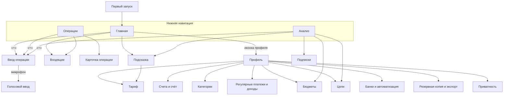

# UX-спецификация Android MVP

Документ описывает экраны, навигацию, состояния и сценарии MVP. Требования, на которые он опирается, — в [документе требований](../plans/2026-11-10-2326-feat-android-mvp-plan.md); ссылки вида R16 ведут туда. Визуальный стиль и макеты — отдельным шагом после выбора направления.

## 1. Принципы интерфейса

1. **Сначала ответ, потом детали.** Каждый экран начинается с вывода («можно тратить 1 000 ₽»), а цифры и графики открываются по касанию.
2. **Одно главное действие на экране.** На главной это «+», во «Входящих» — «Подтвердить», в подсказке — её действие.
3. **Ничего не теряется молча.** Любая проблема (нет доступа, не разобрано уведомление, не хватает денег) видна на главном экране с действием, которое её решает.
4. **Новичку не нужен учебник.** Никаких терминов вроде «транзакция», «баланс по счёту», «MCC». Пишем «покупка», «деньги на карте», «магазин».
5. **Платное видно, но не мешает.** Закрытые подсказки помечены замком и не перекрывают бесплатные функции. Баннеры поверх интерфейса запрещены — это главная жалоба на CoinKeeper.

## 2. Карта экранов

**Нижняя навигация** (R34): три вкладки — Главная, Операции, Анализ — и круглая кнопка «+» по центру. Касание «+» открывает ввод операции, долгое нажатие — сразу голосовой ввод.

**Профиль** открывается иконкой в правом верхнем углу главной. Всё, что настраивается редко, живёт там.

## 3. Экраны

### 3.1 Главная

Порядок блоков сверху вниз. Блоки, которым нечего показать, не отображаются.

| # | Блок | Содержание | Требования |
|---|---|---|---|
| 1 | Шапка | Текущий месяц, иконка профиля | R34 |
| 2 | Главная цифра | Крупно «Можно тратить сегодня: 1 000 ₽». Под ней «До зарплаты 10 000 ₽ · 10 дней». По касанию — расшифровка расчёта | R16 |
| 3 | Тревоги | Нехватка денег перед платежом («Через 3 дня аренда 30 000 ₽, на карте не хватает 5 000 ₽»), сломанная автоматизация («Т-Банк: нет доступа к уведомлениям · Восстановить») | R18, R42 |
| 4 | Входящие | «3 операции ждут подтверждения» с переходом во «Входящие» | R7, R17 |
| 5 | Подсказки | До трёх карточек (в бесплатном тарифе одна). Карточка: вывод в одну строку, эффект в рублях, действие | R17, R19, R36 |
| 6 | Ближайшие платежи | 2–3 ближайших регулярных платежа с датами и суммами | R17 |
| 7 | Потрачено | Сегодня и за месяц, с крупнейшей категорией дня | R17 |

**Расшифровка главной цифры** (нижний лист по касанию): деньги на счетах, минус платежи до дохода (списком), минус взносы на цели, делённое на дни. Это снимает недоверие к цифре и учит без обучения.

**Состояния главной цифры:**
- нормально — число;
- ноль или минус — «0 ₽», причина и сумма нехватки (R16);
- доход не задан — расчёт до конца месяца и ссылка «Указать доход — цифра станет точнее» (R16, R32);
- нет счетов — экран не показывается, вместо него первый запуск.

### 3.2 Ввод операции

Нижний лист поверх текущего экрана.

| Элемент | Поведение | Требования |
|---|---|---|
| Тип | Переключатель сверху: Расход (по умолчанию), Доход, Перевод | R1, R12 |
| Сумма | Своя цифровая клавиатура, открыта сразу | R1 |
| Категории | 6 предложенных категорий крупными плитками под суммой и «Ещё». Касание категории сохраняет операцию | R1, R2 |
| Счёт и дата | Одна строка «Т-Банк · сегодня» над категориями, касание открывает выбор | R1 |
| Микрофон | Кнопка рядом с суммой | R34 |
| Комментарий | Скрыт за «Добавить комментарий» | — |

Пока сумма не введена, плитки категорий неактивны. Без истории предлагаются популярные категории из готового набора.

После сохранения — короткое уведомление «Сохранено · Отменить» на 5 секунд.

### 3.3 Голосовой ввод

1. **Слушаю.** Анимация микрофона, распознанный текст появляется по мере речи. Кнопка «Готово».
2. **Карточки.** Для каждой операции — карточка: сумма, тип, категория, магазин, счёт, дата. Любое поле правится касанием. Кнопки «Сохранить» (одна карточка) или «Сохранить все» (несколько) (R3, R4).
3. **Не удалось.** Если сумма не распознана, поле суммы подсвечено, сохранить нельзя. Если фраза не распознана совсем — переход в ручной ввод с текстом фразы в комментарии.
4. **Нет разрешения на микрофон** — объяснение и кнопка перехода в настройки.

### 3.4 Операции

- Сверху сегмент **«Входящие · 3»**, если есть неподтверждённые.
- Ниже лента, сгруппированная по дням, с итогом дня.
- Поиск по магазину и комментарию, фильтры по счёту, категории, типу.
- Касание операции открывает карточку: правка всех полей, удаление (с отменой).

### 3.5 Входящие

Очередь всего, что требует внимания пользователя. Каждая строка — одно действие.

| Тип записи | Как выглядит | Главное действие | Требования |
|---|---|---|---|
| Новый магазин | «Пятёрочка · 1 240 ₽ · предлагаем: Продукты» | Подтвердить (или выбрать категорию) | R7, R8 |
| Не удалось разобрать | «ВТБ · 2 300 ₽ · не удалось разобрать» с распознанными полями | Дополнить и сохранить | R41 |
| Перевод без пары | «Перевод 5 000 ₽ на карту *1234» | «Перевод себе» / «Расход» | R9 |
| Расхождение остатка | «Т-Банк: в банке 12 400 ₽, у нас 13 100 ₽» | «Принять баланс банка» / «Найти пропущенную» | R10, R40 |
| После лимита | Обычная операция с пометкой «бесплатный лимит исчерпан» | Подтвердить; до подтверждения не влияет на баланс | R38 |

Свайп вправо — подтвердить с предложенной категорией.

### 3.6 Анализ

Сверху выбор периода: неделя, месяц, год, свой период.

| Блок | Бесплатно | Платно | Требования |
|---|---|---|---|
| Итоги периода: доходы, расходы, остаток | да | да | R36 |
| Расходы по категориям и сравнение с прошлым периодом в цифрах | да | да | R36 |
| Подсказки | одна | все, с действиями | R19–R23, R36, R37 |
| Недельная сводка | да | да | R24, R36 |
| Месячная сводка | замок | да | R24, R37 |
| Подписки | список из регулярных платежей | с подсказками о подорожании и похожих | R15, R21 |
| Бюджеты: прогресс и прогноз | да | да | R25 |
| Цели: прогресс и прогноз даты | да | да | R26 |

**Карточка закрытой подсказки** в бесплатном тарифе: тип подсказки и замок, без суммы. Касание открывает экран тарифа.

**Мало данных:** «Сравнения появятся через 18 дней. Пока смотрите темп месяца и ближайшие платежи» (R20).

### 3.7 Подсказка (развёрнутая)

- Вывод: «Доставка еды: +35% к обычной неделе».
- База сравнения: «обычная неделя — медиана за 2 месяца, 3 100 ₽».
- Эффект: «+1 100 ₽ за неделю, около 4 700 ₽ в месяц».
- Действие: «Поставить лимит 3 000 ₽ в неделю».
- «Полезно» / «Не актуально» (R22).
- Если есть цель: «Сократив доставку на 30%, накопите на отпуск на 2 месяца раньше» (R27).

### 3.8 Профиль

| Раздел | Содержание | Требования |
|---|---|---|
| Счета | Список с балансами; добавить счёт | R11 |
| Категории | Набор, подкатегории, отметка «обязательная» | R13, R14 |
| Доходы и регулярные платежи | Ручные и найденные автоматически | R15, R32 |
| Бюджеты | Лимиты по категориям | R25 |
| Цели | Список целей | R26 |
| Банки и автоматизация | Выбранные банки, статус доступа к уведомлениям, «Восстановить», счётчик бесплатного лимита | R5, R42, R44, R38 |
| Резервная копия и экспорт | Статус системной копии, предупреждение без блокировки экрана, «Сохранить копию в файл» и «Восстановить из файла» с паролем, экспорт CSV | R29, R30, R46 |
| Приватность | Согласие на обезличенные события, объяснение, что отправляется | R45 |
| Тариф | Текущий тариф, оплата через RuStore | R37, R39 |
| Внешний вид | Светлая, тёмная, как в системе | R35 |

### 3.9 Счёт

- Название, тип (дебетовая, кредитная, наличные), банк.
- Для кредитной карты: долг, лимит, доступно.
- Баланс и история операций по счёту.
- **«Указать фактический остаток»** — ввод суммы, разница пишется корректировкой (R40).

### 3.10 Цель и бюджет

- **Цель:** название, сумма, желаемая дата → приложение показывает «откладывать 7 500 ₽ в месяц» и прогноз даты по текущему темпу (R26).
- **Бюджет:** категория, лимит в месяц → прогноз «при текущем темпе лимит кончится 22-го» (R25).

### 3.11 Тариф

- Сравнение бесплатного и платного в 4–5 строках: автоматические операции (лимит / без лимита), автоподтверждение, подсказки (одна / все), месячная сводка.
- Цены за месяц и год.
- Оплата через RuStore.
- Строка «Условия для оплативших не меняются» (R39).
- Никаких таймеров и «скидка сгорит через 5 минут».

## 4. Первый запуск

Цель — сумма «можно тратить» за 2 минуты (R32, R44).

| Шаг | Экран | Можно пропустить |
|---|---|---|
| 1 | Приветствие: одна фраза о том, что умеет приложение, кнопка «Начать» | — |
| 2 | Счета и балансы: «Где у вас деньги?» Карточки банков и «Наличные», ввод остатка | нет (нужен хотя бы один счёт) |
| 3 | Доходы: по умолчанию «Аванс» и «Зарплата» с датами и суммами, можно удалить один или добавить | да |
| 4 | Регулярные платежи: готовые варианты (аренда, связь, интернет, кредит, подписки) с суммами и датами | да |
| 5 | Банки: «Какими банками пользуетесь?» Если есть Т-Банк, ВТБ или Озон Банк — шаг 6, иначе сообщение, что автоучёт для них пока недоступен | — |
| 6 | Доступ к уведомлениям: что читаем, что не читаем, где хранятся данные; кнопка «Разрешить» открывает системные настройки | да |
| 7 | Готово: «Можно тратить сегодня: 1 000 ₽» и расшифровка | — |

Согласие на обезличенные события (R45) спрашивается не в первом запуске, а через несколько дней, отдельной карточкой: так онбординг короче.

## 5. Основные сценарии

### 5.1 Покупка картой (F2)

Оплата картой → уведомление банка → операция в ленте (известный магазин) или во «Входящих» (новый) → обновлены «можно тратить» и потрачено за день.

### 5.2 Покупка наличными голосом (F3)

«+» → микрофон (или долгое нажатие «+») → фраза → карточка → «Сохранить» → уведомление «Сохранено · Отменить».

### 5.3 Недельная сводка (F4)

Понедельник утром уведомление: «Неделя: 14 200 ₽, на 1 800 ₽ меньше обычного. Доставка выросла на 35%» → экран сводки → действие по подсказке или «Не актуально».

### 5.4 Не хватает денег перед платежом

Главная показывает тревогу «Через 3 дня аренда 30 000 ₽, не хватает 5 000 ₽» → касание открывает расшифровку: что спишется, сколько есть, сколько нужно.

### 5.5 Автоматизация сломалась

Нет уведомлений от банка дольше обычного или доступ отозван → тревога на главной «ВТБ: автоучёт не работает · Восстановить» → инструкция: открыть настройки доступа, отключить экономию батареи для приложения.

### 5.6 Бесплатный лимит

За 5 операций до конца лимита — карточка на главной «Осталось 5 автоматических операций в этом месяце». После исчерпания — операции во «Входящих» с пометкой, подтверждаются одним касанием, до подтверждения не влияют на баланс. Предложение тарифа — одной карточкой на главной, без всплывающих окон.

### 5.7 Первая неделя

День 1–7: главная цифра, ближайшие платежи, темп месяца. Карточка «Сравнения с обычными тратами появятся через N дней». Первая подсказка с эффектом в рублях — из темпа месяца или подписок, указанных в онбординге (R20).

## 6. Тексты интерфейса

- Числа всегда с разрядами и знаком рубля: «12 400 ₽».
- Без «успешно», «пожалуйста», восклицательных знаков.
- Подсказки — одна строка вывода, затем эффект: «Кафе: +2 100 ₽ к обычному месяцу».
- Подсказки о подписках — вопросом: «Пользуетесь Кинопоиском? 399 ₽ в месяц» (R23).
- Обращение к пользователю на «ты» (решено 2026-11-11 вместе с направлением B). Приложение не говорит о себе в первом лице и не использует глаголы с родом: «Распознано», а не «Я услышал»; «2 операции — проверь», а не «Нашёл 2 операции».

## 7. Визуальный язык (направление B «Смелый», выбрано 2026-11-11)

Макеты: [холст Design](https://claude.ai/artifact/8nNuSJcqUjziNx2cZ5NETs), второй ряд «Направление B: ключевые экраны».

**Характер:** тёмный интерфейс, один неоновый акцент, крупная широкая цифра «можно тратить», скруглённые карточки и «пилюли». Молодо и запоминается, при этом чисто: на экране один акцент, всё остальное — оттенки серого.

**Шрифты:** Unbounded (500, 700) для главной цифры, заголовков экранов и вывода подсказки; Inter (400, 500, 600) для всего остального. Оба поддерживают кириллицу.

**Цвета тёмной темы:**

| Роль | Цвет |
|---|---|
| Фон | #0E0F12 |
| Карточки | #1A1C22 |
| Элементы внутри карточек, клавиши | #24262E, #2A2D36 |
| Границы | #2C2F38 |
| Основной текст | #F4F4F5 |
| Второстепенный текст | #A1A1AA |
| Акцент (действия, главная цифра, активная вкладка) | #C6F432, текст на нём #0E0F12 |
| Предупреждение (фон / текст) | #2A1C12 / #FDBA74 |

**Светлая тема** (R35): фон #F2F3EE, карточки #FFFFFF, текст #0E0F12, второстепенный #55575E. Лаймовый акцент на белом нечитаем как цвет текста, поэтому в светлой теме он работает только как заливка: главная цифра на лаймовой плашке, а основные кнопки чёрные с лаймовым значком.

**Формы:** карточки скругление 18–20 px, кнопки и переключатели — «пилюли». Нижняя навигация — плавающая капсула с тремя вкладками и отдельной круглой кнопкой «+» справа. Минимальная высота касаемых элементов 44 px.

**По умолчанию** тема как в системе (R35); тёмная — основная, на ней проверяются макеты.

## 8. Открытые вопросы

- **Название продукта и тарифа** — на макетах тариф назван «Полный», цены и лимит стоят заглушками [ЦЕНА] и [ЛИМИТ].
- **Иконки категорий** — в макетах простые линейные иконки; набор нужно выбрать или нарисовать.
