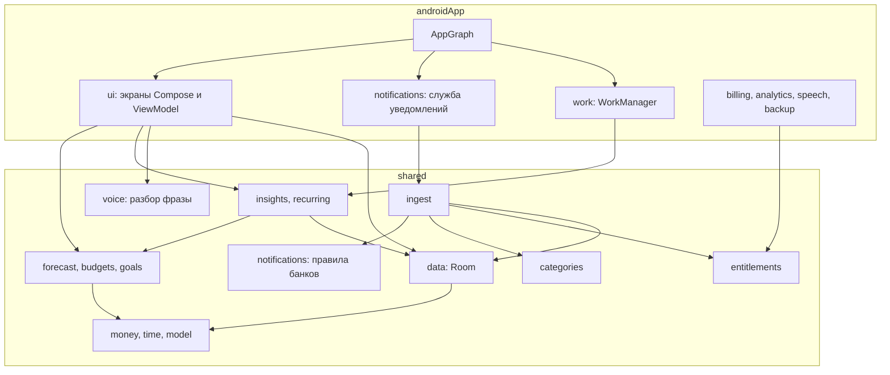
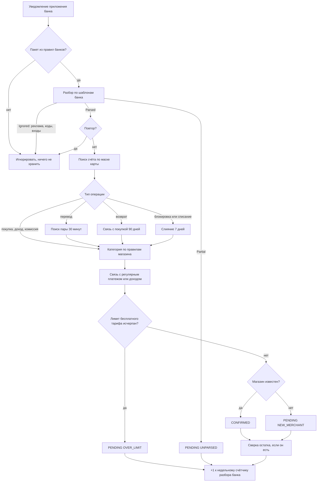
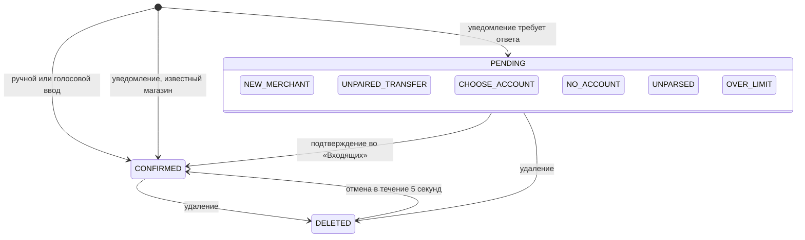
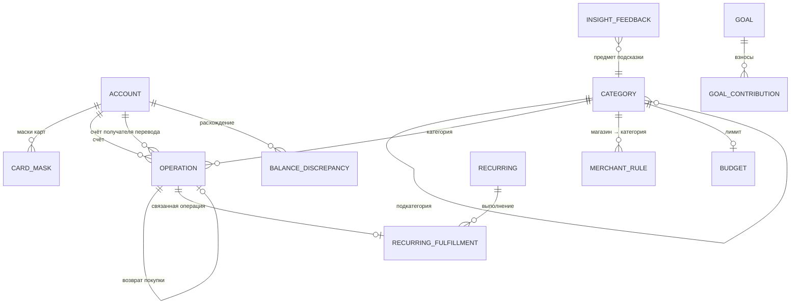
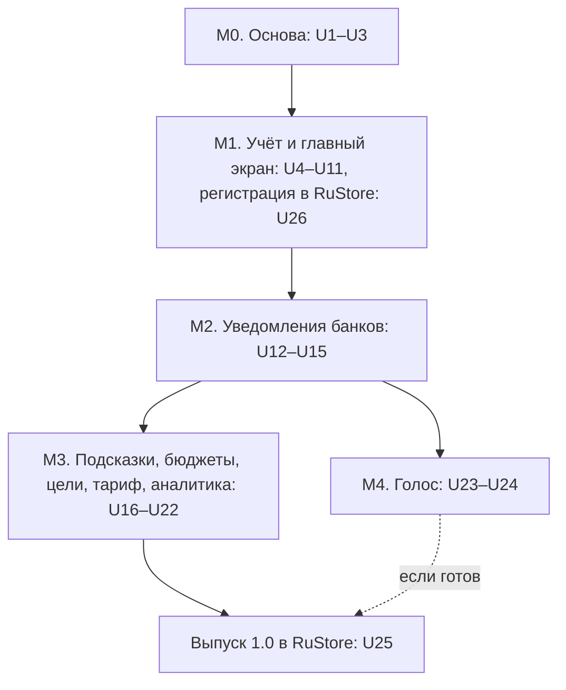

# Android MVP личных финансов - Plan

## Goal Capsule

- **Objective:** человек, который раньше не вёл учёт денег, тратит на учёт секунды в день и каждую неделю получает понятные выводы: сколько можно тратить, что изменилось и где можно сэкономить в рублях.
- **Means:** общий модуль Kotlin Multiplatform с логикой и базой, Android-приложение на Jetpack Compose, данные только на телефоне, распространение через RuStore (KTD1, KTD2).
- **Product authority:** владелец продукта (Ramazan). Решения из раздела Key Decisions приняты им на этапе Research и Brainstorm 2026-11-10, архитектура согласована 2026-11-11 (`docs/architecture/2026-11-11-architecture.md`). iOS, Web и синхронизация — не текущий объём работ.
- **Execution profile:** один разработчик с Claude. Работа идёт по единицам U1–U26 через `ce-work`, одна единица — один коммит. После каждой вехи (KTD24) владелец ставит сборку на свой телефон и пользуется ею. Коммиты и отправка на GitHub — только по просьбе владельца.
- **Who ships:** код пишет Claude; сборку подписывает и публикует в RuStore владелец (U25).
- **Stop conditions:** остановиться и спросить владельца, если (1) работа дошла до вопроса из Outstanding Questions (Q1–Q4); (2) проверка на устройстве опровергает принятое решение: подписки в RuStore Pay SDK недоступны или доступ к уведомлениям заблокирован для установок из RuStore; (3) изменение меняет поведение, описанное в R1–R46; (4) не удаётся собрать реальные уведомления хотя бы одного банка для тестов.
- **Open blockers:** нет. Правила Google Play и способ оплаты в РФ проверены на этапе архитектуры. Вопросы Q1–Q4 блокируют только отдельные единицы, начало работ они не блокируют. Q3 нужно решить к концу вехи M1: от него зависит регистрация в RuStore (U26).

---

## Product Contract

### Summary

Android-приложение для новичков в учёте денег. Главный экран показывает, сколько можно тратить сегодня, и 1–3 подсказки. Операции появляются сами из уведомлений Т-Банка, ВТБ и Озон Банка, офлайн-покупки вносятся голосом или в два касания. Аналитика объясняет изменения с эффектом в рублях, бюджеты и цели прогнозируют результат. Данные хранятся на телефоне, а их зашифрованная копия — в Google Drive пользователя; сервера нет.

### Problem Frame

Владелец продукта больше двух лет ведёт учёт в CoinKeeper. Привычка сформировалась, но приложение осталось инструментом статистики: оно показывает, куда ушли деньги, но не анализирует привычки, не находит ненужные регулярные траты, не предлагает, как сэкономить, и требует ручного ввода каждой операции.

Рынок подтверждает обе проблемы. Главная причина, по которой люди бросают учёт, — утомительный ручной ввод. Автоматизация у конкурентов в РФ (CoinKeeper, Дзен-мани) по отзывам 2025–2026 годов часто ломается. Персональных рекомендаций с расчётом денежного эффекта на рынке РФ/СНГ нет ни у кого. Новичок, который начинает учёт в обычном трекере, сталкивается сразу с обеими проблемами: много ввода и мало пользы, — и бросает через несколько недель.

### Key Decisions

- **Основная аудитория — новички, которые раньше не вели учёт.** Простота важнее глубины; импорт старой истории не нужен. (session-settled: user-directed — chosen over опытных пользователей, уходящих от CoinKeeper и Дзен-мани: новичков больше, и для них продукт решает главную проблему категории) Governs R1, R32.
- **Концепция A+B: «финансовый навигатор» на фундаменте быстрого ввода и объясняющей аналитики; конверты — позже.** (session-settled: user-directed — chosen over отдельных концепций A, B или C: навигатор задаёт ценность, ввод и аналитика дают для неё данные) Governs R16, R17.
- **Рынок РФ/СНГ: русский язык и рубль в MVP, модель данных готова к другим валютам и языкам.** (session-settled: user-approved — chosen over международного запуска и обоих рынков сразу: быстрее и ближе к владельцу продукта) Governs R11.
- **MVP без аккаунта и сервера; шифрованный бэкап в Google Drive.** (session-settled: user-approved — chosen over аккаунта и облака с первого релиза: быстрее и приватнее, синхронизация придёт с iOS и Web) Governs R28, R29, R30.
- **Автоматизация платная, с бесплатным месячным лимитом автоматических операций.** (session-settled: user-directed — chosen over рекомендованного варианта «автоматизация одного банка бесплатно» и над пробным периодом: польза автоматизации видна постоянно, а платят за экономию времени) Governs R36, R37, R38.
- **Бесплатно видны одна подсказка на главном экране и недельная сводка с одной подсказкой; остальные подсказки и месячная сводка платные.** (session-settled: user-directed — chosen over полностью платных подсказок, тизера без деталей и полностью бесплатных подсказок: новичок сразу видит пользу и понимает, за что платить) Governs R36, R37.
- **После исчерпания лимита операции подтверждаются одним касанием и до подтверждения не влияют на баланс.** (session-settled: user-directed — chosen over ручного выбора категории после лимита и счётчика незаписанных покупок: новичок не бросает учёт из-за лимита, а платный тариф продаётся автоподтверждением и подсказками) Governs R38.
- **Формула «можно тратить» учитывает плановые взносы на цели.** (session-settled: user-directed — chosen over формулы без взносов и формулы с ожидаемыми обязательными тратами: цели копятся сами, а цифру легко объяснить) Governs R16.
- **Бэкап — системное резервное копирование Android с шифрованием ключом блокировки экрана.** (session-settled: user-directed — chosen over пароля восстановления и ключа рядом с бэкапом: без паролей, которые новичок забудет, и без формального шифрования) Governs R29.
- **Главная гипотеза проверяется обезличенными событиями использования с согласия пользователя.** (session-settled: user-directed — chosen over отказа от телеметрии и отчёта по кнопке: иначе эффект подсказок не отделить от оплаты) Governs R31, R45.
- **Три типа подсказок обязательны, остальные пять первыми переносятся в 1.1 при нехватке времени.** (session-settled: user-directed — chosen over урезания MVP до трёх типов и равноправия всех восьми: платный тариф сильный на старте, но есть понятная линия отсечения) Governs R21.
- **MVP распространяется только через RuStore.** (session-settled: user-directed — chosen over RuStore плюс бесплатной версии в Google Play: только в RuStore работает оплата от российских пользователей, одна сборка и одна модерация) Governs R37.
- **Ручная резервная копия в файл с паролем для телефонов без сервисов Google.** (session-settled: user-directed — chosen over только экспорта CSV и переноса в 1.1: без неё пользователь без сервисов Google теряет всю историю вместе с телефоном) Governs R46.
- **Чтение уведомлений Т-Банка, ВТБ и Озон Банка в MVP.** (session-settled: user-directed — chosen over Сбера, Альфа-Банка и других: владелец продукта пользуется этими банками и может проверять на своих данных) Governs R5.
- **Финансовые цели входят в MVP.** (session-settled: user-directed — chosen over рекомендованного переноса в версию 1.1: цели удерживают и связывают рекомендации с мотивацией) Governs R26, R27.
- **Логины и пароли от банков не запрашиваются и не хранятся никогда.** Подход «вход в интернет-банк от имени пользователя» отвергнут из-за безопасности, правил банков и хрупкости. Governs R31.
- **Разбор голосовой фразы и уведомлений выполняется на устройстве.** Языковые модели в MVP не используются: это бесплатно, предсказуемо и данные не покидают телефон. Governs R3, R6, R31.

---

### Requirements

**Ввод операций**

- R1. Пользователь добавляет расход в два касания: «+» открывает ввод суммы, касание одной из предложенных категорий сохраняет операцию; счёт и дата подставляются по умолчанию.
- R2. Предложенные при ручном вводе категории подбираются по истории пользователя с учётом времени суток и дня недели.
- R3. Голосовой ввод превращает фразу («продукты в Пятёрочке две с половиной тысячи», «получил зарплату 120 тысяч») в карточку операции с суммой, типом, категорией, магазином или получателем, счётом и датой, которую пользователь подтверждает одним касанием или правит.
- R4. Голосовой ввод распознаёт несколько операций в одной фразе («кофе 250 и такси 600») и показывает отдельную карточку для каждой.

**Автоматический учёт из уведомлений банков**

- R5. Приложение получает операции из push-уведомлений приложений Т-Банка, ВТБ и Озон Банка после того, как пользователь дал доступ к уведомлениям.
- R6. Из уведомления извлекаются сумма, тип операции, магазин или получатель, карта и, если есть, остаток; полный текст уведомления не сохраняется и не покидает устройство.
- R7. Автоматически полученные операции попадают во «Входящие»: операция с известным магазином подтверждается сама, операция с новым магазином ждёт подтверждения категории одним касанием.
- R41. Уведомление поддержанного банка с суммой, которое не удалось разобрать, попадает во «Входящие» с пометкой «не удалось разобрать» и уже распознанными полями для подтверждения вручную.
- R8. Исправление категории запоминается для этого магазина и применяется к следующим операциям.
- R9. Переводы между своими счетами распознаются как переводы и не считаются расходом или доходом. Перевод без парного уведомления (например, на карту неподдержанного банка) попадает во «Входящие» с вопросом «перевод себе или расход?».
- R43. Возврат покупки уменьшает расход категории исходной покупки. Блокировка суммы и последующее списание на ту же сумму в том же магазине в течение нескольких дней сливаются в одну операцию.
- R10. Если уведомление содержит остаток, приложение сверяет его с балансом счёта (для кредитной карты — с разницей лимита и задолженности). При расхождении приложение показывает сообщение с двумя действиями: «Принять баланс банка» (создаёт корректировку по R40) и «Найти пропущенную операцию» (открывает ввод).

**Счета, категории, регулярные платежи**

- R11. Пользователь ведёт несколько счетов трёх типов: дебетовая карта, кредитная карта, наличные. У каждого счёта есть валюта, в MVP везде рубль. У кредитной карты хранятся лимит и задолженность.
- R12. Переводы между счетами вносятся вручную, если не пришли из уведомлений.
- R40. Пользователь одним действием указывает фактический остаток любого счёта. Разница записывается корректировкой, которая не считается ни расходом, ни доходом и не попадает в аналитику.
- R13. Категории задаются готовым набором с одним уровнем подкатегорий; пользователь может их переименовать, добавить и скрыть.
- R14. Каждая категория отмечена как обязательная или необязательная; значения заданы по умолчанию и меняются одним переключателем.
- R15. Регулярные платежи и поступления (зарплата, аренда, связь, подписки) задаются вручную и обнаруживаются автоматически: одинаковый получатель и близкая сумма повторяются с устойчивым периодом не менее трёх раз.

**Главный экран и прогноз**

- R16. Главный экран показывает сумму «до следующего дохода» и «можно тратить сегодня». «До следующего дохода» = собственные деньги на счетах − регулярные платежи до ближайшего дохода − плановые взносы на цели до него; «можно тратить сегодня» = эта сумма ÷ число дней до ближайшего дохода. Доступный кредитный лимит не входит в собственные деньги. Если доход не задан, период расчёта — до конца календарного месяца. Если сумма равна нулю или меньше, показывается «0 ₽», причина и сумма нехватки.
- R17. Главный экран показывает потраченное за день и за месяц, ближайшие регулярные платежи, неподтверждённые «Входящие» и не больше трёх подсказок (в бесплатном тарифе — одна, по R36). Если кандидатов больше, показываются подсказки с наибольшим эффектом в рублях.
- R18. Приложение предупреждает заранее, если на счёте не хватит денег для ближайшего регулярного платежа.
- R42. Если автоматизация не работает (доступ к уведомлениям отозван, служба отключена системой или от поддержанного банка давно нет уведомлений), главный экран показывает это с действием «Восстановить».

**Аналитика и подсказки**

- R19. Каждая подсказка называет базу сравнения и денежный эффект в месяц или в год и, если возможно, предлагает действие одним касанием (например, поставить лимит).
- R20. Подсказка показывается только при достаточном объёме данных; пока данных мало, приложение говорит, когда появятся выводы. Сравнения опираются на медиану, а не на среднее. Подсказки, которым не нужна история (темп расходов и прогноз месяца, нехватка денег на платёж, регулярные платежи и подписки из онбординга), показываются с первой недели.
- R21. Обязательные типы подсказок MVP: изменение категории относительно обычного уровня; темп расходов и прогноз конца месяца; найденные подписки, их подорожание и похожие подписки. Ещё пять типов тоже входят в MVP, но первыми переносятся в 1.1 при нехватке времени: сумма мелких покупок; цена привычки в год; рост расходов в первые дни после зарплаты; банковские комиссии; положительные изменения.
- R22. Пользователь отмечает подсказку «Полезно» или «Не актуально». «Не актуально» скрывает подсказку этого типа только для этой категории или подписки, а не весь тип.
- R23. Подсказки о подписках формулируются как вопрос («пользуетесь ли?»), потому что приложение не знает, используется ли подписка.
- R24. Недельная сводка (итог, 2–3 изменения, одна подсказка) приходит уведомлением раз в неделю; месячная сводка (доходы, расходы, остаток, категории, изменения, подписки, подсказки на следующий месяц) доступна в разделе анализа.

**Бюджеты и цели**

- R25. Пользователь задаёт месячный лимит на категорию; приложение прогнозирует дату превышения по текущему темпу и предупреждает заранее.
- R26. Пользователь создаёт финансовую цель с суммой и желаемой датой; приложение показывает прогноз даты достижения и сколько откладывать в месяц.
- R27. Подсказки связывают экономию с целью, если цель есть («сократив доставку на 30%, накопите на 2 месяца раньше»).

**Данные и приватность**

- R28. Данные хранятся на устройстве в зашифрованном виде; сервера в MVP нет. Вне устройства существуют только зашифрованная копия в Google Drive пользователя (R29) и обезличенные события использования без финансовых данных (R45).
- R29. Бэкап выполняется системным резервным копированием Android: копия данных хранится в Google Drive пользователя, зашифрованная ключом блокировки экрана, и восстанавливается автоматически при установке приложения на новом телефоне. Если на телефоне нет блокировки экрана, приложение предупреждает, что копия не защищена, и предлагает включить блокировку.
- R30. Пользователь экспортирует все операции в CSV.
- R46. Пользователь сохраняет резервную копию всех данных в файл, зашифрованный его паролем, и восстанавливает данные из такого файла на новом телефоне. На телефонах без системного бэкапа (без сервисов Google) приложение само предлагает сделать такую копию. При создании копии приложение предупреждает, что без пароля её не восстановить.
- R31. Приложение не запрашивает и не хранит логины, пароли и коды банков; финансовые данные не передаются сторонним сервисам аналитики.
- R45. С согласия пользователя приложение отправляет в сервис аналитики обезличенные события использования (открытие приложения, показ подсказки, отметки «Полезно» и «Не актуально») без сумм, магазинов, категорий и текста уведомлений. Без согласия ничего не отправляется.

**Онбординг и интерфейс**

- R32. Первый запуск за 2 минуты собирает счета и балансы, один или несколько регулярных доходов с датами и суммами (по умолчанию предлагаются аванс и зарплата) и регулярные платежи; шаги доходов и платежей можно пропустить. Затем приложение запрашивает доступ к уведомлениям с объяснением, что финансовые данные хранятся на телефоне и в зашифрованной копии в Google Drive пользователя и больше никуда не передаются. В конце пользователь видит свою сумму «можно тратить сегодня».
- R44. Перед запросом доступа к уведомлениям приложение спрашивает, какими банками пользуется человек. Если среди них нет Т-Банка, ВТБ или Озон Банка, доступ не запрашивается, а приложение сообщает, что автоматический учёт для этих банков пока недоступен, и продолжает по R33.
- R33. Если пользователь отказал в доступе к уведомлениям, приложение полностью работает с ручным и голосовым вводом и позже мягко предлагает включить автоматизацию.
- R34. Навигация: три вкладки (Главная, Операции, Анализ) и кнопка «+» (касание — ручной ввод, долгое нажатие — голос). На экране ввода суммы есть видимая кнопка микрофона. Счета, категории, регулярные платежи, бюджеты, цели и настройки доступны из профиля.
- R35. Есть светлая и тёмная темы.

**Монетизация**

- R36. Бесплатный тариф: ручной и голосовой ввод, счета, категории, регулярные платежи, главный экран с суммой «можно тратить» (R16–R18), одна подсказка на главном экране (с наибольшим эффектом в рублях), недельная сводка с одной подсказкой, бюджеты, цели, история, базовые отчёты (доходы и расходы по категориям за выбранный период и сравнение с прошлым периодом в цифрах) и ограниченное число автоматических операций в месяц. Рекламы нет ни в одном тарифе.
- R37. Платный тариф (месяц и год) снимает лимит автоматических операций, включает автоподтверждение операций с известными магазинами и открывает все подсказки (до трёх на главном экране, раздел анализа, связь с целями по R27) и месячную сводку.
- R38. Когда бесплатный лимит близок к исчерпанию, приложение предупреждает заранее. После исчерпания операции из уведомлений банков не теряются: они приходят во «Входящие» и подтверждаются одним касанием, а до подтверждения не влияют на баланс и сумму «можно тратить».
- R39. Условия тарифа для уже оплативших пользователей не ухудшаются.

---

### Key Flows

- F1. Первый запуск
  - **Trigger:** пользователь установил приложение.
  - **Steps:** счета и балансы → регулярные доходы (по умолчанию аванс и зарплата, можно пропустить) → регулярные платежи из готовых вариантов (можно пропустить) → выбор своих банков → доступ к уведомлениям с объяснением, если есть поддержанный банк → главный экран с суммой «можно тратить сегодня».
  - **Covered by:** R16, R32, R33, R44
- F2. Покупка картой
  - **Trigger:** пользователь оплатил покупку картой Т-Банка, ВТБ или Озон Банка.
  - **Steps:** банк присылает уведомление → приложение извлекает операцию → известный магазин подтверждается сам, новый ждёт подтверждения категории во «Входящих» → баланс и «можно тратить» обновляются.
  - **Covered by:** R5, R6, R7, R8, R16
- F3. Покупка наличными голосом
  - **Trigger:** пользователь нажимает микрофон на экране ввода суммы (или держит кнопку «+») и произносит фразу.
  - **Steps:** распознавание → карточка операции → «Сохранить» или правка поля.
  - **Covered by:** R3, R4
- F4. Недельная сводка
  - **Trigger:** начало недели.
  - **Steps:** уведомление со сводкой → открытие раздела анализа → действие по подсказке (например, поставить лимит) или отметка «Не актуально».
  - **Covered by:** R19, R22, R24, R25

---

### Acceptance Examples

- AE1. **Covers R7, R8.** **Given** пользователь раньше отнёс «Пятёрочку» к категории «Продукты», **when** приходит уведомление о покупке в «Пятёрочке», **then** операция сохраняется в «Продукты» без действий пользователя и видна в ленте.
- AE2. **Covers R7.** **Given** магазин встречается впервые, **when** приходит уведомление, **then** операция ждёт во «Входящих» с предложенной категорией и подтверждается одним касанием.
- AE3. **Covers R9.** **Given** пользователь перевёл деньги с карты Т-Банка на свою карту ВТБ, **when** приходят уведомления обоих банков, **then** приложение записывает один перевод между счетами, а не расход и доход.
- AE4. **Covers R20.** **Given** у пользователя 10 дней истории, **when** он открывает раздел анализа, **then** сравнений с обычным уровнем нет, а приложение сообщает, через сколько дней они появятся.
- AE5. **Covers R33.** **Given** пользователь отказал в доступе к уведомлениям, **when** он пользуется приложением, **then** ручной и голосовой ввод, бюджеты, цели и главный экран работают полностью.
- AE6. **Covers R38.** **Given** бесплатный лимит автоматических операций исчерпан, **when** приходит уведомление банка, **then** операция ждёт во «Входящих» подтверждения одним касанием, до подтверждения не меняет баланс, а приложение предлагает платный тариф.
- AE8. **Covers R16.** **Given** собственных денег 30 000 ₽, до зарплаты 10 дней, до неё списывается аренда 15 000 ₽, а плановый взнос на цель 5 000 ₽, **when** пользователь открывает главный экран, **then** он видит «до следующего дохода» 10 000 ₽ и «можно тратить сегодня» 1 000 ₽.
- AE7. **Covers R18.** **Given** через 3 дня списание аренды 30 000 ₽, а на счёте 25 000 ₽, **when** пользователь открывает главный экран, **then** он видит предупреждение о нехватке 5 000 ₽.

---

### Success Criteria

- Новичок проходит первый запуск и видит сумму «можно тратить сегодня» за 2 минуты или быстрее.
- Ручной ввод расхода занимает не больше 3 секунд, голосовой — не больше 5 секунд от начала фразы до сохранения.
- Не менее 90% уведомлений поддержанных банков разбираются в операцию без ошибок в сумме и типе.
- Первая подсказка с эффектом в рублях появляется не позже двух недель после установки.
- Главная гипотеза MVP: подсказки удерживают пользователей дольше обычного трекера. Проверка: доля новичков, активных на 8-й неделе после установки, сравнивается с рыночным оттоком через 2–6 недель; пользователи сравниваются по тому, видели ли они подсказки, а не по тому, платят ли. Данные — обезличенные события по R45.

---

### Scope Boundaries

**Deferred for later**

- iOS, Web, аккаунт и синхронизация между устройствами.
- Импорт выписок (PDF, CSV) и истории из CoinKeeper.
- Чеки (QR-код, «Мои чеки онлайн»), состав заказов маркетплейсов, распознавание скриншотов.
- Банки помимо Т-Банка, ВТБ и Озон Банка; SMS банков.
- Открытые API банков РФ и агрегаторы для других стран.
- Подсказки на основе языковых моделей и ИИ-ассистент с вопросами.
- Режим конвертов, совместный бюджет, годовой отчёт, мультивалютность в интерфейсе.

**Outside this product's identity**

- Вход в интернет-банк от имени пользователя с хранением его логина и пароля.
- Реклама и продажа финансовых продуктов (кредитов, карт) пользователям.

**Deferred to Follow-Up Work**

- Виджет на рабочем столе, ярлыки на иконке приложения и шаблоны частых операций. Они описаны в исследовании, но не входят в R1–R46.
- Цели iOS (`iosArm64`, `iosSimulatorArm64`) в общем модуле. Их добавят вместе с iOS-версией (KTD3).
- Обновление правил разбора уведомлений без выпуска новой версии приложения: для этого нужен сервер (KTD13).
- Проверка покупок на своём сервере (KTD21).
- Скриншот-тесты интерфейса.

---

### Dependencies / Assumptions

- MVP распространяется только через RuStore. В правилах Google Play отдельного запрета на доступ к уведомлениям не найдено (проверено 2026-11-11), действуют общие правила о раскрытии и согласии; публикация в Google Play отложена.
- Верификация разработчиков Android для России запланирована Google на 2027 год; верификацию разработчика и регистрацию имени пакета нужно пройти заранее (см. `docs/architecture/2026-11-11-architecture.md`, раздел 1).
- Формат уведомлений Т-Банка, ВТБ и Озон Банка содержит сумму и магазин. Смена формата вероятна (исследование оценивает её вероятность как высокую); последствия смягчают R41 и R42.
- Биллинг Google Play для пользователей из России приостановлен с марта 2022 года (подтверждено 2026-11-11). Оплата — через RuStore Pay SDK; старый RuStore BillingClient перестал работать 1 августа 2026 года.
- MVP крупный для одного разработчика. Предлагаемый порядок выпуска: учёт и главный экран → уведомления банков → подсказки, бюджеты и цели → голос. При нехватке времени первыми переносятся в 1.1 голосовой ввод и необязательные типы подсказок (R21).
- Системное резервное копирование Android подтверждено по документации Android: до 25 МБ на приложение, копия создаётся не чаще раза в 24 часа, шифрование на стороне клиента ключом блокировки экрана работает на Android 9 и новее при включённой блокировке экрана. Поведение на конкретных телефонах проверяется по чек-листу устройств (U11).

---

### Outstanding Questions

**Решения владельца продукта (не блокируют начало работ)**

- Q1. Число бесплатных автоматических операций в месяц и цены тарифов за месяц и за год. Условие из требований: лимит не должен заканчиваться раньше первых подсказок, то есть раньше двух недель. Предложение для решения: 50 операций в месяц (при 3 покупках картой в день их хватает примерно на 16 дней); 199 ₽ в месяц и 1 490 ₽ в год (ориентиры рынка 177–299 ₽ в месяц). Блокирует окончательные значения в U21 и выпуск (U25). В коде лимит и цены — константы.
- Q2. Как деньги, уже отложенные на цель, влияют на «можно тратить». R16 вычитает только плановые взносы. После взноса деньги остаются на счетах в приложении и снова считаются собственными, поэтому сумма «можно тратить» вырастет сразу после взноса. Варианты: (а) взнос на цели записывается кнопкой «Отложить», отложенное вычитается из собственных денег и показывается в расшифровке строкой «отложено на цели» (рекомендуется: работает при любом наборе счетов); (б) цель привязывается к счёту-копилке, который не входит в собственные деньги (нужен новый признак счёта в R11). Блокирует часть U19 про взносы в R16.
- Q3. Название продукта и имя пакета (`applicationId`). Имя пакета нельзя сменить после первой публикации. Блокирует регистрацию приложения в RuStore (U26) в конце вехи M1. От неё зависят проверки на устройстве в U14 и U21 и выпуск (U25).
- Q4. Отправлять ли отчёты о сбоях. R28 перечисляет всё, что покидает телефон: копию в Google Drive и события по R45. Отчётов о сбоях в этом списке нет, а без них разработчик не узнает о падениях после выпуска. Предложение для решения: отправлять их по тому же согласию, что и события R45, только с классом исключения и стеком, без текста сообщений (KTD20), и дописать это в R28 и R45. Блокирует подключение отчётов о сбоях в U22; остальная работа U22 от него не зависит.

---

### Sources / Research

- `docs/research/2026-11-10-market-research.md` — рынок, CoinKeeper, конкуренты, первые согласованные решения.
- `docs/research/2026-11-10-product-vision.md` — матрица автоматизации с уровнем достоверности, голосовой ввод, каталог подсказок, варианты монетизации, риски, требования к стеку.
- `docs/design/2026-11-11-ux-spec.md` — экраны, навигация, состояния, онбординг, тексты интерфейса, визуальный язык (направление B, обращение на «ты»). Макеты: https://claude.ai/artifact/8nNuSJcqUjziNx2cZ5NETs
- `docs/architecture/2026-11-11-architecture.md` — выбор стека, структура модулей, технические решения T1–T13.

---

## Planning Contract

**Product Contract preservation:** требования R1–R46, Key Decisions, Key Flows и Acceptance Examples не изменены. Вопросы «Deferred to Planning» решены в KTD ниже, вместо них в Outstanding Questions остались решения владельца Q1–Q4. Пункт о системном бэкапе в Dependencies обновлён подтверждёнными фактами. В Scope Boundaries добавлен список «Deferred to Follow-Up Work», в Sources / Research — UX-спецификация и архитектура.

### Key Technical Decisions

**Стек и сборка**

- KTD1. **Общий модуль Kotlin Multiplatform `shared` и Android-приложение `androidApp` на Jetpack Compose.** В `shared` живут модель, расчёты, подсказки, разбор уведомлений и голоса, конвейер приёма операций и база Room. В `androidApp` — интерфейс, службы Android и платформенные SDK (RuStore Pay, AppMetrica, распознавание речи). (session-settled: user-approved — chosen over Flutter и React Native с React: фоновая обработка уведомлений остаётся на одном языке без мостов) Источник: `docs/architecture/2026-11-11-architecture.md`, разделы 4, 5, 9.
- KTD2. **Решения T1–T13 из архитектурного документа обязательны.** План фиксирует только уточнения: T7 уточняет KTD13, T9 — KTD19, T10 — KTD20.
- KTD3. **Цели сборки общего модуля в MVP — `androidTarget` и `jvm`, без iOS.** Цель `jvm` запускает тесты общего кода на компьютере за секунды. Она же не даёт коду в `commonMain` зависеть от Android API: такой код не скомпилируется. Цели iOS требуют Mac и добавляются вместе с iOS-версией.
- KTD4. **Библиотеки.** Версии берутся последними стабильными на момент U1 и фиксируются в `gradle/libs.versions.toml`; каждая должна поддерживать minSdk 26 (T12).
  - Kotlin 2.x с плагином компилятора Compose, kotlinx-coroutines, kotlinx-datetime, kotlinx-serialization.
  - Room (Kotlin Multiplatform) с драйвером `sqlite-bundled`. Встроенный SQLite одинаков на Android 8–16 и в тестах на `jvm`; он нужен для `VACUUM INTO` (KTD18). Цена — около 1 МБ к размеру APK.
  - Jetpack Compose (BOM), Material 3, Navigation Compose с типизированными маршрутами, Lifecycle ViewModel, WorkManager, DataStore Preferences.
  - RuStore Pay SDK (BOM `ru.rustore.sdk:bom`, артефакт `ru.rustore.sdk:pay`), AppMetrica SDK, Vosk Android.
  - Тесты: kotlin.test, kotlinx-coroutines-test, Turbine, Robolectric с Compose UI Test.
- KTD5. **Зависимости собираются вручную в одном объекте `AppGraph`, без DI-фреймворка.** `AppGraph` создаётся в `Application`. Экраны, служба уведомлений и фоновые задачи берут из него одни и те же экземпляры базы и репозиториев. Граф небольшой (около десяти сервисов), поэтому Koin или Hilt добавили бы зависимость без выигрыша.
- KTD6. **Пространство имён кода — `ru.pfc`; `applicationId` выбирает владелец (Q3).** Пространство имён Kotlin не связано с `applicationId`, поэтому код пишется до решения Q3; само решение нужно к регистрации в RuStore (U26). Отладочная сборка получает суффикс `.debug` и ставится рядом с релизной.

**Данные**

- KTD7. **Модель данных с полями для будущей синхронизации (T3); баланс считается от последней точки отсчёта.** Схема — на ERD в High-Level Technical Design.
  - Начальный баланс и фактический остаток по R40 записываются корректировкой (тип `ADJUSTMENT`). Корректировка хранит разницу (R40) и остаток на свой момент времени. Баланс счёта равен остатку последней корректировки плюс операции строго позже неё. Операции раньше корректировки остаются в истории и аналитике, но баланс не меняют: покупка из шторки, сделанная до ввода начального остатка, не спишется второй раз.
  - Корректировка «Принять баланс банка» (R10) получает время уведомления с остатком. Операция из того же уведомления имеет то же время и в баланс второй раз не входит: банк её уже учёл. Из двух корректировок с одним временем последней считается изменённая позже (`updatedAt`). Операция, склеенная из двух уведомлений (KTD14, шаги 3 и 5), хранит время первого: остатки, которые банк называет после него, её уже учитывают.
  - Сумма операции хранится в валюте счёта. Сумма в иностранной валюте хранится отдельным полем `originalAmount` (A13).
  - Регулярная запись (R15) — платёж или доход с периодом (неделя, две недели, месяц, квартал, год) и датой отсчёта. Каждая дата считается от даты отсчёта, а не от предыдущей, поэтому число 29–31 не уползает: 31 января → 28 февраля → 31 марта. Поэтому дата отсчёта выбирается так: для записи на 29–31 число берётся ближайший прошедший месяц, в котором это число есть (для «31-го» 24 ноября — 31 октября: тогда ближайшим платежом остаётся 30 ноября, а 31 декабря сохраняется); автопоиск (KTD11) берёт повторение с самым большим числом месяца.
  - Баланс кредитной карты равен минус задолженности, доступный лимит хранится отдельно (R11).
  - У неподтверждённой операции статус `PENDING` и причина: `NEW_MERCHANT`, `UNPAIRED_TRANSFER`, `UNPARSED`, `OVER_LIMIT`, `CHOOSE_ACCOUNT`, `NO_ACCOUNT`. Какие из них входят в баланс, определяет допущение A2.
  - Операция из уведомления хранит банк. Счёт может отсутствовать только у `UNPARSED` и `NO_ACCOUNT` (у банка нет счёта в приложении; во «Входящих» действие «Создать счёт»). `CHOOSE_ACCOUNT` временно привязывается к последнему использованному счёту этого банка; выбор во «Входящих» переносит операцию на другой счёт.
  - Удаление мягкое: заполняется `deletedAt`, все запросы такие записи пропускают.
- KTD8. **Время берётся из внедряемых часов и часового пояса телефона.** Операция хранит момент времени и локальную дату: дату по часовому поясу телефона в момент операции. День, неделя и месяц для ленты, лимита, бюджетов и статистики определяются по локальной дате, поэтому после смены часового пояса операция остаётся в том же дне и месяце. Дата 29–31 в коротком месяце переносится на последний день месяца.

**Расчёты**

- KTD9. **«Можно тратить» — чистая функция над снимком данных, которая возвращает расшифровку.** Расшифровка — тот же объект, что показывает нижний лист на главной (UX 3.1). (session-settled: user-directed — chosen over формулы без взносов и формулы с ожидаемыми обязательными тратами: цели копятся сами, а цифру легко объяснить) Governs R16. Механика, которую R16 не задаёт:
  - платёж считается выполненным, если с ним связана операция в пределах ±5 дней от даты или пользователь отметил его оплаченным;
  - операция связывается с невыполненным регулярным платежом или доходом, если совпадает ключ магазина или получателя (KTD10), а для платежа без магазина — категория; сумма отличается не больше чем на 15%, дата — не больше чем на 5 дней. Связь создаётся при приёме из уведомления, при ручном и голосовом вводе и при подтверждении во «Входящих»; действие «Оплачено» создаёт её вручную;
  - доход, пришедший раньше даты и связанный с регулярным доходом, считается полученным: период идёт до следующего дохода;
  - невыполненный платёж с датой не старше 5 дней по-прежнему вычитается;
  - предупреждение о нехватке (R18) проверяет платежи до ближайшего дохода, но не меньше чем на 7 дней вперёд; платёж без счёта сравнивается с суммой собственных денег.
- KTD10. **Подбор категорий и нормализация магазинов работают в общем модуле.**
  - R2: шесть категорий выбираются по частоте в том же интервале суток (4 интервала) и том же типе дня (будни или выходные) за 90 дней с бо́льшим весом недавних операций. Без истории — популярные категории из готового набора.
  - Магазин приводится к ключу: нижний регистр, без цифр, города и юридической формы, с транслитерацией для известных брендов («PYATEROCHKA 4821 MOSCOW» → тот же ключ, что «Пятёрочка»).
  - Готовый словарь популярных магазинов РФ задаёт категорию для нового магазина (AE2). Исправление пользователя хранится как правило с источником `USER` и важнее словаря (R8).
- KTD11. **Регулярные платежи обнаруживаются по группам операций одного магазина (R15).** Условия: не меньше трёх операций, интервалы около 7, 14, 30, 90 или 365 дней с допуском ±3 дня для месячного периода, суммы в пределах ±15% от медианы. Подписка — регулярный платёж из словаря подписок или из категории «Подписки». Словарь задаёт группы похожих сервисов (музыка, кино) для подсказки о похожих подписках.
- KTD12. **Подсказки считаются детерминированными правилами (T8) в одном движке.** У каждого типа подсказки свои проверка достаточности данных, поиск кандидатов, денежный эффект в месяц, ключ «тип + предмет» и действие. Движок сортирует кандидатов по эффекту (R17), применяет «Не актуально» по ключу (R22) и фильтр тарифа (R36, R37). Нехватка денег перед платежом остаётся тревогой на главной (UX 3.1, блок 3) и в ранжирование подсказок не входит. Пересчёт идёт после изменения данных и раз в сутки. Пороги по умолчанию (допущение A6) — в таблице. (session-settled: user-directed — chosen over урезания MVP до трёх типов и равноправия всех восьми: платный тариф сильный на старте, но есть понятная линия отсечения) Governs R21.

| Тип | Обязательный | Данных достаточно, когда | Показывается, когда | Эффект в месяц для ранжирования |
|---|---|---|---|---|
| Изменение категории | да | история не меньше 28 дней и траты в категории были хотя бы в 4 из последних 8 недель | текущая неделя выше медианы недельных трат за 8 недель на 25% и больше | превышение над медианой × 4,33 |
| Темп и прогноз месяца | да | с 3-го дня месяца | прогноз остатка на конец месяца есть всегда в анализе; на главной — только прогноз нехватки | сумма прогнозной нехватки |
| Подписки | да | сразу: регулярные платежи из онбординга и найденные по R15 | есть подписка; цена выросла на 5% и больше; две подписки одной группы | цена подписки в месяц; при подорожании — разница цен |
| Мелкие покупки | нет | история не меньше 28 дней | покупки до 500 ₽ за 30 дней дают не меньше 3 000 ₽ и не меньше 15 покупок | 30% суммы мелких покупок |
| Цена привычки | нет | история не меньше 28 дней | магазин или подкатегория: не меньше 8 покупок и 1 500 ₽ за 30 дней | 30% месячной суммы; в тексте — сумма за год |
| Рост после зарплаты | нет | не меньше двух полных периодов между доходами | траты первых 5 дней после дохода в 1,5 раза выше медианы дневных трат остального периода | превышение за 5 дней × число доходов в месяц |
| Комиссии банков | нет | сразу | за 30 дней есть операции-комиссии | сумма комиссий за 30 дней |
| Положительные изменения | нет | как у изменения категории | неделя ниже медианы на 20% и больше | сэкономленная сумма в месяц |

Для всех типов, кроме подписок, кандидат с эффектом меньше 300 ₽ в месяц не показывается. При 10 днях истории сравнения появятся через 18 дней (AE4).

**Автоматизация**

- KTD13. **Правила разбора уведомлений описываются декларативными данными на Kotlin, по файлу на банк (уточняет T7).** Правило банка — список имён пакетов и упорядоченный список шаблонов: регулярное выражение с именованными группами, соответствие групп полям и тип операции. Разбор — чистая функция «пакет, заголовок, текст, время → результат»: `Parsed`, `Partial` (R41) или `Ignored`. JSON-файл с правилами не нужен: без сервера правила всё равно обновляются только с новой версией приложения, а перенос в JSON позже механический. Сообщения об ошибках разбора не содержат входного текста (T6).
- KTD14. **Конвейер приёма операций выполняет шаги в одной транзакции базы, в таком порядке:**
  1. Повтор отсеивается по ключу и времени публикации уведомления (`StatusBarNotification.key`, `postTime`) и по отпечатку разобранных полей в пределах 2 минут. Хеш текста не хранится.
  2. Счёт находится по маске карты. Если у банка ровно один счёт, неизвестная маска привязывается к нему; если счетов несколько — причина `CHOOSE_ACCOUNT` (KTD7); если счёта нет — причина `NO_ACCOUNT`.
  3. Перевод ищет парное уведомление другого банка на ту же сумму в пределах 30 минут (AE3), иначе — `UNPAIRED_TRANSFER`. Склеенный перевод хранит время первого из двух уведомлений (KTD7).
  4. Возврат ищет исходную покупку в том же магазине за 90 дней.
  5. Блокировка и списание на ту же сумму в том же магазине в пределах 7 дней сливаются в одну операцию (R43) со временем блокировки (KTD7).
  6. Категория назначается по правилам магазина (KTD10).
  7. Расход или доход связывается с регулярным платежом или доходом (KTD9).
  8. Проверяется бесплатный лимит: операции сверх лимита получают `OVER_LIMIT` (R38). (session-settled: user-directed — chosen over ручного выбора категории после лимита и счётчика незаписанных покупок: новичок не бросает учёт из-за лимита, а платный тариф продаётся автоподтверждением и подсказками) Governs R38.
  9. Операция записывается.
  10. Если уведомление содержит остаток, он сверяется с балансом счёта на момент уведомления (R10), к которому прибавлены неподтверждённые `OVER_LIMIT` и `UNPARSED` этого счёта с известной суммой. Если на счёте есть `UNPARSED` без суммы, сверка пропускается. На счёт открыто не больше одного расхождения. Уведомления из шторки обрабатываются по возрастанию времени публикации, и открытое расхождение заменяется только расхождением по более позднему уведомлению.
- KTD15. **`NotificationListenerService` только доставляет текст в конвейер.** Служба фильтрует пакеты по правилам банков, ничего не пишет в журнал и при подключении обрабатывает уже показанные уведомления (повторы отсеивает шаг 1 KTD14). При отключении службы она запрашивает повторное подключение через `requestRebind`. Состояние автоматизации считается по каждому банку (R42) фоновой задачей раз в 6 часов и при открытии приложения:
  - `OK`;
  - `NO_ACCESS`: приложения нет в списке разрешённых для доступа к уведомлениям;
  - `DISCONNECTED`: служба отключена и не подключилась снова;
  - `SILENT`: от банка нет уведомлений дольше, чем max(3 дня, 3 × медианный интервал за 30 дней). Проверяется только после 5 уведомлений от этого банка.
- KTD16. **Реальные уведомления для тестов собираются отладочной службой, которой нет в релизной сборке.** Служба лежит в наборе исходников `debug` и появляется в U1, чтобы корпус копился во время вехи M1: возвраты, блокировки и комиссии случаются редко. На телефоне владельца она пишет тексты уведомлений трёх банков в личный файл приложения и отдаёт его через «Поделиться». На компьютере сырой файл лежит только в каталоге `captures/`, который исключён из git, и удаляется после подготовки примеров. В репозиторий примеры попадают только обезличенными: другие цифры карт, остатков, счетов, договоров и телефонов, вымышленные имена в переводах.

**Платформа**

- KTD17. **Правила системного бэкапа: в копию входят база и настройки DataStore.** База входит целиком, вместе с файлами `-wal` и `-shm`: без них восстановленная база теряет последние записи. Исключаются модель Vosk, временные файлы, служебное состояние автоматизации и идентификаторы аналитики. Правила задаются двумя файлами: `data_extraction_rules.xml` для Android 12 и новее и `backup_rules.xml` для старых версий. Флаг `requireFlags="clientSideEncryption"` не ставится: по R29 копия нужна и без блокировки экрана, в этом случае пользователь видит предупреждение. Публичного способа узнать, включён ли бэкап, у Android нет, поэтому приложение ставит свой `BackupAgent` с `android:fullBackupOnly="true"`:
  - агент выполняет стандартную полную копию по этим правилам и записывает в файл вне бэкапа время копии и флаг шифрования на стороне клиента (`FLAG_CLIENT_SIDE_ENCRYPTION_ENABLED`);
  - во время бэкапа система не создаёт класс `Application` приложения, поэтому агент не использует `AppGraph`;
  - профиль показывает дату последней системной копии;
  - предупреждение R29 показывается, если копия прошла без шифрования на стороне клиента: так бывает без блокировки экрана и всегда на Android 8. До первой копии предупреждение опирается на `KeyguardManager.isDeviceSecure` и версию Android;
  - если системной копии нет дольше 7 дней, а операции есть, приложение предлагает копию в файл, как на телефоне без сервисов Google (R46). (session-settled: user-directed — chosen over пароля восстановления и ключа рядом с бэкапом: без паролей, которые новичок забудет, и без формального шифрования) Governs R29.
- KTD18. **Копия в файл (R46): снимок базы через `VACUUM INTO`, шифрование AES-256-GCM ключом PBKDF2-HMAC-SHA256.** (session-settled: user-directed — chosen over только экспорта CSV и переноса в 1.1: без неё пользователь без сервисов Google теряет всю историю вместе с телефоном) Governs R46. Параметры: 600 000 итераций, случайная соль 16 байт. Заголовок файла (метка формата, версия формата, версия схемы, параметры PBKDF2, nonce) проверяется как дополнительные данные GCM. Пароль вводится дважды, длина не меньше 8 символов, нигде не хранится. Файл сохраняется и открывается через Storage Access Framework, разрешение на память не нужно. Телефон без сервисов Google определяется по отсутствию пакета `com.google.android.gms`; тогда приложение само предлагает копию. Восстановление:
  1. Файл расшифровывается во временный.
  2. Если версия схемы новее, чем в приложении, пользователь видит просьбу обновить приложение.
  3. Проверяется целостность базы.
  4. Конвейер приёма приостанавливается, база закрывается, файл базы подменяется. Уведомления, пришедшие в эти секунды, служба обработает после перезапуска из списка показанных уведомлений (KTD15).
  5. База открывается с миграциями, процесс приложения перезапускается.
- KTD19. **Речь распознаётся только на устройстве: системный распознаватель, если он поддерживает русский офлайн, иначе Vosk (уточняет T9).**
  - На Android 12 и новее используется `SpeechRecognizer.createOnDeviceSpeechRecognizer`. На Android 13 и новее поддержка `ru-RU` проверяется через `checkRecognitionSupport`, недостающая модель скачивается через `triggerModelDownload`.
  - Во всех остальных случаях работает Vosk с моделью `vosk-model-small-ru-0.22` (около 45 МБ). Модель скачивается при первом голосовом вводе после согласия пользователя с размером, проверяется по SHA-256 и хранится в каталоге без бэкапа. В APK модель не входит, чтобы не увеличивать установку на 45 МБ.
  - Обычный `createSpeechRecognizer` не используется никогда: на части телефонов он отправляет голос на серверы.
- KTD20. **AppMetrica включается только после согласия (уточняет T10).** (session-settled: user-directed — chosen over отказа от телеметрии и отчёта по кнопке: иначе эффект подсказок не отделить от оплаты) Governs R31, R45. До согласия SDK не активируется вовсе, отзыв согласия выключает отправку. Сбор местоположения выключен; сбор рекламных идентификаторов выключается, если SDK даёт такую настройку. Автоматические отчёты AppMetrica о сбоях выключены. Отправлять ли отчёты о сбоях вообще, решает владелец (Q4). Если да, собственный обработчик после согласия отправляет только класс исключения и стек, без текста сообщений, в том числе у вложенных причин: в сообщениях могут оказаться суммы и магазины (R31). События задаёт закрытый список типов в одном месте кода:
  - `app_open`;
  - `insight_shown` с параметрами «тип подсказки» и «место показа»;
  - `insight_feedback` с параметрами «тип подсказки» и «отметка»;
  - `notification_parse_weekly` раз в неделю с банком и числом результатов `Parsed` и `Partial` за неделю (допущение A12). На каждое отдельное уведомление в AppMetrica ничего не уходит: поток таких событий показал бы, когда и в каком банке человек платит.
- KTD21. **Тариф вычисляется в общем модуле; RuStore Pay SDK живёт в Android-модуле.** (session-settled: user-directed — chosen over RuStore плюс бесплатной версии в Google Play: только в RuStore работает оплата от российских пользователей, одна сборка и одна модерация) Governs R37.
  - В общем модуле: счётчик автоматических операций за местный календарный месяц (пара уведомлений перевода считается одной операцией), предупреждение при 5 оставшихся (UX 5.6), набор доступных функций и версия условий тарифа. Версию условий задаёт идентификатор товара подписки (например, `premium_month_v1`), который `getPurchases` возвращает на любом телефоне. При изменении условий заводятся новые товары для новых покупателей, а оплатившие сохраняют свои условия и после переустановки (R39).
  - В Android-модуле: покупка подписок на месяц и год и проверка статуса через `getPurchases` с фильтром подписок; оплаченным считается статус `ACTIVE`. Последний подтверждённый статус кешируется, без связи с RuStore он действует 14 дней (допущение A7).
  - Подписка в RuStore требует входа через VK ID. Покупки, привязанные к аккаунту, восстанавливаются на новом телефоне.
  - Своего сервера нет, поэтому проверка статуса идёт на телефоне. Риск взлома APK принят для MVP.
- KTD22. **Интерфейс: одна Activity, экраны на Compose, у экрана ViewModel со `StateFlow` состояния.** Навигация — Navigation Compose с типизированными маршрутами; ввод операции — нижний лист. Цвета, формы и шрифты берутся из UX §7: Unbounded и Inter лежат в `res/font` (лицензия OFL). Иконки категорий — Material Symbols Outlined (лицензия Apache 2.0); это закрывает открытый вопрос UX об иконках. Строки только на русском, обращение на «ты» (UX §6).
- KTD23. **Фоновая работа идёт через WorkManager, уведомления разделены по каналам.**
  - Задачи: недельная сводка в понедельник в 9:00 по местному времени (R24), ежедневный пересчёт подсказок и поиск регулярных платежей, проверка автоматизации раз в 6 часов (KTD15).
  - Каналы: «Недельная сводка», «Предупреждения» (R18, R25), «Автоматизация» (R42).
  - На Android 13 и новее разрешение на уведомления запрашивается карточкой на главной после первого запуска, а не в онбординге (допущение A10).

**Процесс**

- KTD24. **Работа идёт вехами M0–M4, публичный выпуск 1.0 — после M3 и U25.** Порядок вех повторяет порядок выпуска из Dependencies. После каждой вехи владелец пользуется сборкой на своём телефоне. Голос (M4) входит в 1.0, если готов к выпуску, иначе переходит в 1.1. Необязательные типы подсказок (U18) — первая единица, которую переносят в 1.1 при нехватке времени.
- KTD25. **Тесты: логика общего модуля пишется через тесты, интеграции с платформой проверяются на устройстве.**
  - Три обязательных набора из T13 пишутся до кода: «можно тратить» (U4), подсказки (U17, U18), разбор уведомлений на реальных обезличенных примерах (U12).
  - DAO и конвейер приёма проверяются на базе в памяти в тестах `jvm`.
  - Ключевые сценарии интерфейса (ввод в два касания, «Входящие», онбординг) проверяются тестами Robolectric.
  - Служба уведомлений, бэкап, покупка и речь проверяются по чек-листу устройств `docs/qa/device-checklist.md`.

### High-Level Technical Design

**Зависимости пакетов**



**Приём операции из уведомления**



**Статусы операции**



В баланс и «можно тратить» входят `CONFIRMED`, `NEW_MERCHANT`, `UNPAIRED_TRANSFER` и `CHOOSE_ACCOUNT`; `NO_ACCOUNT`, `UNPARSED` и `OVER_LIMIT` не входят (допущение A2).

**Статус операции из уведомления по тарифу**

| Тариф и лимит | Известный магазин | Новый магазин |
|---|---|---|
| Бесплатный, лимит не исчерпан | `CONFIRMED` | `PENDING NEW_MERCHANT` |
| Бесплатный, лимит исчерпан | `PENDING OVER_LIMIT` | `PENDING OVER_LIMIT` |
| Платный | `CONFIRMED` | `PENDING NEW_MERCHANT` |

Первая строка опирается на допущение A3, вторая — на R38.

**Формат правил банка**

Набросок ниже — ориентир для KTD13, а не спецификация: точные поля задают собранные примеры (U12).

```text
BankRule
  bank: TBANK | VTB | OZON
  packages: [имя пакета, ...]
  templates: [Template, ...]       проверяются по порядку, побеждает первый совпавший
Template
  kind: PURCHASE | INCOME | TRANSFER_OUT | TRANSFER_IN | REFUND | HOLD | HOLD_CANCEL | FEE | IGNORE
  source: TITLE | TEXT | TITLE_AND_TEXT
  pattern: регулярное выражение с группами amount, currency, merchant, card, balance, counterpart
  required: [amount, ...]          нет обязательной группы → Partial
```

**Схема данных**



У каждой таблицы есть `id` (UUID), `updatedAt` и `deletedAt` (T3). Таблица повторов уведомлений и снимок подсказок служебные, на схеме не показаны.

**Вехи**



### Output Structure

```text
settings.gradle.kts
build.gradle.kts
gradle.properties
gradle/libs.versions.toml
.github/workflows/ci.yml
docs/qa/device-checklist.md
docs/release/rustore-release.md
docs/privacy/privacy-policy.md
shared/
  build.gradle.kts
  schemas/                                  экспорт схем Room
  src/commonMain/kotlin/ru/pfc/shared/
    money/  time/  model/
    data/          AppDatabase, entities/, dao/, repository/, seed/
    categories/    подбор категорий, нормализация магазинов, словарь
    forecast/      «можно тратить», расписание платежей, нехватка
    stats/         потрачено за день и месяц, отчёты за период
    recurring/     поиск регулярных платежей, словарь подписок
    notifications/ разбор, rules/ по банкам
    ingest/        конвейер приёма операций
    inbox/         действия во «Входящих»
    insights/      движок, rules/, пороги
    budgets/  goals/  entitlements/  automation/
    voice/         разбор голосовой фразы, числа словами
    backup/        формат файла копии
    csv/           экспорт CSV
  src/androidMain/kotlin/ru/pfc/shared/data/   сборка базы на Android
  src/jvmMain/kotlin/ru/pfc/shared/data/       сборка базы для тестов
  src/commonTest/kotlin/ru/pfc/shared/...      тесты логики
  src/jvmTest/kotlin/ru/pfc/shared/...         тесты базы и конвейера
androidApp/
  build.gradle.kts
  proguard-rules.pro
  src/main/AndroidManifest.xml
  src/main/kotlin/ru/pfc/app/
    App.kt  AppGraph.kt  MainActivity.kt
    ui/            theme/ components/ navigation/ onboarding/ home/ entry/ voice/
                   operations/ inbox/ analysis/ insight/ profile/ accounts/ categories/
                   recurring/ budgets/ goals/ backup/ automation/ paywall/ privacy/
    notifications/ служба уведомлений, состояние автоматизации
    work/          фоновые задачи, канал уведомлений
    backup/        копия в файл, шифрование, окружение
    billing/       RuStore Pay
    analytics/     AppMetrica
    speech/        распознавание речи, модель Vosk
  src/main/res/xml/   data_extraction_rules.xml  backup_rules.xml
  src/main/res/font/  Unbounded, Inter
  src/debug/kotlin/ru/pfc/app/debug/        сбор уведомлений для тестов
  src/test/kotlin/ru/pfc/app/...            тесты Robolectric
```

Дерево показывает ожидаемую форму. Точный список файлов задают поля **Files** в единицах.

### Assumptions

Это толкования требований, которые владелец ещё не подтверждал. Каждое можно поменять, не перестраивая план.

- A1. Кредитная карта входит в «собственные деньги» по R16 со знаком минус: учитывается задолженность, доступный лимит не учитывается. Иначе покупка кредиткой не уменьшала бы «можно тратить».
- A2. Операции во «Входящих» с причинами `NEW_MERCHANT`, `UNPAIRED_TRANSFER` и `CHOOSE_ACCOUNT` сразу меняют баланс: деньги уже ушли, вопрос только в категории или счёте. `OVER_LIMIT` (по R38), `UNPARSED` (тип операции неизвестен) и `NO_ACCOUNT` (счёта нет) не меняют баланс до подтверждения. В ленте ожидающие операции видны с меткой «ждёт подтверждения»; в итог дня и «Потрачено» входят только те, что входят в баланс.
- A3. В бесплатном тарифе в пределах лимита операции работают как в R7: известный магазин подтверждается сам. «Автоподтверждение» в R37 означает, что у платного тарифа нет ручных подтверждений после лимита.
- A4. Дни в R16 считаются от сегодняшнего дня включительно до дня дохода, не включая его. Без дохода период длится до 1-го числа следующего месяца (11 ноября → 20 дней). Платёж в день дохода относится к следующему периоду. Зарплата, пришедшая раньше даты, учитывается через связь операции с регулярным доходом (KTD9).
- A5. Найденные автоматически регулярные платежи сразу входят в расчёт R16 с пометкой «найдено автоматически»; пользователь может их удалить.
- A6. Пороги подсказок в таблице KTD12 — начальные значения. Их подстраивают на данных владельца во время вехи M3.
- A7. Оплаченный тариф без связи с RuStore сохраняется 14 дней.
- A8. Публичный выпуск 1.0 — после вехи M3 и U25; до этого сборки получает только владелец (KTD24).
- A9. Доход по умолчанию в онбординге: аванс 25-го и зарплата 10-го числа, обе даты можно изменить.
- A10. Push-уведомления: недельная сводка (R24), нехватка денег перед платежом (R18), прогноз превышения бюджета (R25), сломанная автоматизация (R42). Разрешение на уведомления запрашивается карточкой на главной.
- A11. Блокировка, после которой за 7 дней не пришло списание или отмена, остаётся расходом. Уведомление об отмене блокировки удаляет её.
- A12. Недельное событие `notification_parse_weekly` с банком и числом полностью и частично разобранных уведомлений добавлено к списку событий R45. В нём нет финансовых данных и времени операций (T6); оно нужно для проверки критерия «90% уведомлений разобраны».
- A13. Покупка в иностранной валюте обрабатывается как неполный разбор (R41): рубли в MVP, валюта сохраняется в модели. Сумма банка хранится в `originalAmount`, а сумма в валюте счёта остаётся пустой, пока пользователь не укажет, сколько списано. Любая валюта хранится в сотых долях, и иена тоже: 1 500 JPY → 150 000.
- A14. Согласие на аналитику спрашивается карточкой на главной на третий день использования (UX §4).

### Sequencing

Единицы выполняются по зависимостям из Unit Index. Внутри вехи независимые единицы можно делать в любом порядке. Каждая веха заканчивается сборкой на телефоне владельца и проверкой по чек-листу устройств. Две единицы начинаются с проверки на устройстве до основной работы: U14 (доступ к уведомлениям для установки из RuStore) и U21 (подписка через RuStore Pay SDK). Обе требуют приложения, заведённого в RuStore, поэтому U26 выполняется в конце вехи M1, а владелец решает Q3 до неё. Если проверка не проходит, сработало условие остановки из Goal Capsule. Отладочная служба сбора уведомлений (KTD16) стоит на телефоне владельца с конца вехи M0.

### System-Wide Impact

- **Граница приватности.** Текст уведомлений существует только в памяти службы и конвейера. В базе, журналах, отчётах о сбоях, бэкапе и аналитике его нет (R6, R31, T6). Отладочный сбор примеров (KTD16) есть только в сборке `debug`.
- **Фоновое выполнение.** Служба уведомлений и задачи WorkManager пишут в ту же базу, что и интерфейс. Запись идёт в транзакциях, интерфейс получает изменения через `Flow`.
- **Жизненный цикл данных.** Мягкое удаление, миграции Room с экспортом схем, восстановление из системного бэкапа до первого запуска и восстановление из файла с более старой схемой. После восстановления с данными онбординг не показывается, а доступ к уведомлениям нужно дать заново (R42 показывает это на главной).
- **Сбои.** Ошибка в конвейере не роняет службу и не теряет покупку молча (UX §1, принцип 3). Вместо операции во «Входящих» появляется запись `UNPARSED` с банком и временем, без текста. Миграции Room не бывают разрушающими. Если миграция не прошла, приложение показывает экран ошибки с сохранением копии в файл и экспортом CSV, а базу не очищает.
- **Батарея.** Служба работает только при поступлении уведомлений. Фоновые задачи запускаются раз в сутки, раз в неделю и раз в 6 часов.

### Risks & Dependencies

| Риск или зависимость | Что делаем |
|---|---|
| Документация RuStore противоречит сама себе: в журнале изменений Pay SDK 10.0.0 подписки добавлены, а на странице об оплате без установленного RuStore сказано, что подписки через Pay SDK недоступны | U21 начинается с проверки на устройстве: покупка тестовой подписки, чтение `ACTIVE`, восстановление после переустановки. Если подписок нет — стоп и решение владельца (например, разовые покупки на месяц и год) |
| Android 13 и новее блокирует доступ к уведомлениям для приложений из «непроверенных» источников («ограниченные настройки»); в Android 15 правило расширили, и неясно, считается ли RuStore магазином | Проверка в начале U14 на Android 13–16 при установке из RuStore. Инструкция «Восстановить» включает пункт «Разрешить ограниченные настройки» |
| Банк меняет формат уведомлений; имя пакета ВТБ в RuStore не подтверждено (Т-Банк — `com.idamob.tinkoff.android`, Озон Банк — `ru.ozon.fintech.finance`) | Правила с несколькими пакетами на банк (KTD13), проверка пакетов на телефоне владельца в U12, R41 и R42, недельное событие `notification_parse_weekly` |
| Производители телефонов отключают фоновую службу | R42, `requestRebind`, инструкция по исключению из экономии батареи для Xiaomi, Samsung, Huawei |
| Русский офлайн-распознаватель есть не на всех телефонах | Vosk как запасной путь (KTD19); голос — второй кандидат на перенос в 1.1 после U18 (KTD24) |
| Системный бэкап не работает без сервисов Google или при выключенном бэкапе | Копия в файл (R46), дата последней системной копии в профиле и предложение копии в файл, если системной копии нет 7 дней (KTD17) |
| Проверку оплаты на телефоне можно обойти взломом APK | Принято для MVP; серверная проверка — после появления сервера |
| Верификация разработчиков Android в 2027 году | U25: верификация в Android Developer Console и регистрация пакета до выпуска |
| Android 15 скрывает от сторонних приложений уведомления с кодами подтверждения | Покупки и переводы кодов не содержат; поведение проверяется на примерах с Android 15 и новее |
| Условия AppMetrica о хранении данных и настройки идентификаторов не проверены (T10, 🔍) | Проверить при подключении в U22 до первого события |
| Объём MVP для одного разработчика | Вехи и линия отсечения (KTD24) |

### Deferred to Implementation

- Точные регулярные выражения для каждого банка: их задают собранные примеры (U12).
- Имя пакета ВТБ и дополнительные имена пакетов банков в RuStore.
- Версия RuStore Pay SDK, названия методов и коды ошибок в текущей версии.
- Название настройки AppMetrica для отключения рекламных идентификаторов.
- Адрес загрузки и контрольная сумма модели Vosk.
- Финальные значения порогов подсказок после проверки на данных владельца.
- Состав словаря магазинов и словаря подписок.

### Sources & Research

- RuStore Pay SDK, миграция и журнал изменений (подписки с 10.0.0, `getPurchases` с фильтрами, `console_app_id_value`, `sdk_pay_scheme_value`): https://www.rustore.ru/help/en/sdk/pay/migration
- Оплата без установленного RuStore (Pay SDK 9.0.1+, VK ID для подписок, покупки без авторизации видны только на этом устройстве): https://www.rustore.ru/help/en/developers/monetization/without-rustore-app
- Системный бэкап Android (25 МБ, раз в 24 часа, шифрование на Android 9+, `dataExtractionRules`): https://developer.android.com/identity/data/autobackup
- `SpeechRecognizer`, `createOnDeviceSpeechRecognizer`, `checkRecognitionSupport`, `triggerModelDownload`: https://developer.android.com/reference/android/speech/SpeechRecognizer
- Модели Vosk (`vosk-model-small-ru-0.22`, 45 МБ): https://alphacephei.com/vosk/models
- AppMetrica, отключение отправки статистики до согласия: https://appmetrica.yandex.com/docs/en/data-security/notification
- «Ограниченные настройки» в Android 15: https://androidauthority.com/android-15-restricted-settings-sideloading-3481098
- Карточки банков в RuStore: https://www.rustore.ru/catalog/app/com.idamob.tinkoff.android , https://www.rustore.ru/catalog/app/ru.ozon.fintech.finance

---

## Implementation Units

### Unit Index

| U-ID | Единица | Основные файлы | Зависит от |
|---|---|---|---|
| U1 | Каркас проекта, сборка, отладочный сбор уведомлений | `settings.gradle.kts`, `gradle/libs.versions.toml`, `shared/build.gradle.kts`, `androidApp/build.gradle.kts`, `.github/workflows/ci.yml`, `androidApp/src/debug/` | — |
| U2 | Деньги, время, доменная модель | `shared/.../money/`, `time/`, `model/` | U1 |
| U3 | База Room и репозитории | `shared/.../data/` | U2 |
| U4 | Расчёт «можно тратить» и нехватки | `shared/.../forecast/` | U2 |
| U5 | Оболочка приложения и тема | `androidApp/.../ui/theme/`, `ui/navigation/`, `AppGraph.kt` | U1 |
| U6 | Первый запуск | `androidApp/.../ui/onboarding/` | U3, U4, U5 |
| U7 | Ручной ввод и подбор категорий | `shared/.../categories/`, `androidApp/.../ui/entry/` | U3, U4, U5 |
| U8 | Главный экран | `androidApp/.../ui/home/`, `shared/.../stats/` | U4, U5, U6, U7 |
| U9 | Лента операций и карточка операции | `androidApp/.../ui/operations/` | U3, U5 |
| U10 | Профиль: счета, категории, регулярные платежи, внешний вид | `androidApp/.../ui/accounts/`, `ui/categories/`, `ui/recurring/` | U3, U5 |
| U11 | Резервная копия и экспорт | `androidApp/.../backup/`, `res/xml/`, `shared/.../backup/`, `shared/.../csv/` | U3, U6, U10 |
| U12 | Разбор уведомлений банков | `shared/.../notifications/` | U1, U2 |
| U13 | Конвейер приёма операций и набор функций тарифа | `shared/.../ingest/`, `shared/.../entitlements/` | U3, U4, U10, U12 |
| U14 | Служба уведомлений и состояние автоматизации | `androidApp/.../notifications/`, `ui/automation/`, `ui/onboarding/` | U6, U8, U13, U26 |
| U15 | «Входящие» | `androidApp/.../ui/inbox/`, `shared/.../inbox/` | U9, U13 |
| U16 | Регулярные платежи и подписки | `shared/.../recurring/` | U13 |
| U17 | Движок подсказок и три обязательных типа | `shared/.../insights/` | U4, U16 |
| U18 | Пять дополнительных типов подсказок | `shared/.../insights/rules/` | U17 |
| U19 | Бюджеты и цели | `shared/.../budgets/`, `goals/`, `androidApp/.../ui/budgets/`, `ui/goals/` | U4, U10, U17 |
| U20 | Анализ, карточки подсказок, сводки | `androidApp/.../ui/analysis/`, `ui/insight/`, `work/` | U8, U17, U19 |
| U21 | Тарифы и RuStore Pay | `androidApp/.../billing/`, `ui/paywall/` | U13, U17, U20, U26 |
| U22 | Согласие и аналитика | `androidApp/.../analytics/`, `ui/privacy/` | U5, U14, U17 |
| U23 | Разбор голосовой фразы | `shared/.../voice/` | U2, U13 |
| U24 | Голосовой ввод на Android | `androidApp/.../speech/`, `ui/voice/` | U5, U7, U23 |
| U25 | Подготовка к выпуску в RuStore | `docs/release/`, `docs/privacy/`, `androidApp/proguard-rules.pro` | U21, U22, U26 |
| U26 | Регистрация приложения в RuStore (конец вехи M1) | `androidApp/build.gradle.kts`, `docs/release/rustore-release.md`, `docs/privacy/privacy-policy.md` | U1, U11; решение Q3 |

### U1. Каркас проекта, сборка, отладочный сбор уведомлений

**Goal:** собираемый проект из модулей `shared` и `androidApp` с minSdk 26, каталогом версий и CI; отладочная служба сбора уведомлений на телефоне владельца.

**Requirements:** T12; KTD1, KTD3, KTD4, KTD6, KTD16.

**Dependencies:** нет.

**Files:**
- `settings.gradle.kts`, `build.gradle.kts`, `gradle.properties`, `gradle/libs.versions.toml`, `gradle/wrapper/`
- `shared/build.gradle.kts`, `shared/src/commonTest/kotlin/ru/pfc/shared/SmokeTest.kt`
- `androidApp/build.gradle.kts`, `androidApp/proguard-rules.pro`, `androidApp/src/main/AndroidManifest.xml`
- `androidApp/src/main/kotlin/ru/pfc/app/App.kt`, `androidApp/src/main/kotlin/ru/pfc/app/MainActivity.kt`
- `.github/workflows/ci.yml`
- `docs/qa/device-checklist.md`
- `androidApp/src/debug/kotlin/ru/pfc/app/debug/NotificationCaptureService.kt`, `androidApp/src/debug/AndroidManifest.xml`
- `.gitignore` (изменить: `local.properties`, ключи подписи, каталоги сборки, `captures/`)

**Approach:**
1. Подключить плагины Kotlin Multiplatform, Android Application, компилятора Compose, KSP и Room; общий модуль собирается под `androidTarget` и `jvm`.
2. Включить экспорт схем Room в `shared/schemas`.
3. Релизную сборку собирать с R8; ключ подписи читать из `local.properties`, в репозиторий его не класть.
4. CI на push и pull request: тесты общего модуля, тесты Android, lint, отладочная сборка.
5. Чек-лист устройств: матрица версий Android (8, 9, 12, 13, 14, 15, 16) и марок (Xiaomi, Samsung, телефон без сервисов Google); разделы заполняют следующие единицы.
6. Отладочная служба сбора уведомлений (KTD16) в наборе исходников `debug`; отладочная сборка ставится на телефон владельца в конце вехи M0, чтобы корпус примеров копился во время M1.

**Execution note:** это настройка сборки; доказательство — сборка и запуск, а не модульные тесты.

**Test scenarios:** Test expectation: none -- каркас без поведения; `SmokeTest` только подтверждает, что тесты запускаются.

**Verification:** CI проходит; релизная сборка с R8 собирается и не содержит службы сбора; приложение запускается на эмуляторе с API 26 и с последним API; служба сбора на телефоне владельца записывает уведомления трёх банков.

### U2. Деньги, время, доменная модель

**Goal:** типы предметной области в `commonMain`: деньги в копейках, периоды по местному времени, сущности и перечисления.

**Requirements:** R11; T1, T3; KTD7, KTD8.

**Dependencies:** U1.

**Files:**
- `shared/src/commonMain/kotlin/ru/pfc/shared/money/Money.kt`, `MoneyFormat.kt`
- `shared/src/commonMain/kotlin/ru/pfc/shared/time/AppClock.kt`, `Periods.kt`
- `shared/src/commonMain/kotlin/ru/pfc/shared/model/` (счёт, операция, категория, регулярный платёж, бюджет, цель, статусы и причины ожидания)
- `shared/src/commonTest/kotlin/ru/pfc/shared/money/MoneyTest.kt`, `MoneyFormatTest.kt`
- `shared/src/commonTest/kotlin/ru/pfc/shared/time/PeriodsTest.kt`

**Approach:** деньги — value class над `Long` копеек с кодом валюты; сложение с разной валютой и переполнение — ошибка. Формат по UX §6: разряды через неразрывный пробел, знак «₽», копейки только если они не нулевые.

**Test scenarios:**
- 1 240 000 копеек форматируется как «12 400 ₽».
- Ноль форматируется как «0 ₽».
- 123 450 копеек форматируется как «1 234,50 ₽».
- Отрицательная сумма форматируется со знаком минус.
- Сложение рублей и долларов — ошибка.
- Переполнение при сложении — ошибка.
- Платёж 31-го числа в феврале 2027 года приходится на 28 февраля, в феврале 2028 года — на 29 февраля.
- Ежемесячная запись от 31 января приходится на 28 февраля и снова на 31 марта; годовая от 29 февраля 2028 года — на 28 февраля 2029 года.
- Границы декабрьского месяца переходят через год правильно.
- Число дней от 11 ноября до 1 декабря равно 20.
- Покупка в долларах хранит сумму банка и ждёт суммы в валюте счёта; 1 500 JPY форматируется как «1 500 JPY».

**Verification:** тесты общего модуля проходят на `jvm`.

### U3. База Room и репозитории

**Goal:** схема базы, DAO, репозитории с `Flow`, начальные категории и словарь магазинов.

**Requirements:** R11, R13, R14, R28, R40; T2, T3; KTD4, KTD7, KTD10.

**Dependencies:** U2.

**Files:**
- `shared/src/commonMain/kotlin/ru/pfc/shared/data/AppDatabase.kt`, `entities/`, `dao/`, `repository/`
- `shared/src/commonMain/kotlin/ru/pfc/shared/data/seed/DefaultCategories.kt`, `DefaultMerchants.kt`
- `shared/src/androidMain/kotlin/ru/pfc/shared/data/DatabaseBuilder.android.kt`
- `shared/src/jvmMain/kotlin/ru/pfc/shared/data/DatabaseBuilder.jvm.kt`
- `shared/schemas/`
- `shared/src/jvmTest/kotlin/ru/pfc/shared/data/BalanceTest.kt`, `OperationRepositoryTest.kt`, `SeedTest.kt`, `MigrationTest.kt`

**Approach:**
1. Таблицы по ERD из High-Level Technical Design, кроме `INSIGHT_FEEDBACK` (её добавляет U17); у каждой записи `id`, `updatedAt`, `deletedAt`. Служебную таблицу повторов уведомлений добавляет U13. У категории добавляются отметки «обязательная» и «скрытая» (R13, R14).
2. Баланс счёта — остаток последней корректировки плюс операции строго позже неё с учётом допущения A2 (KTD7).
3. Запись нескольких строк идёт в транзакции.
4. Готовый набор категорий с одним уровнем подкатегорий и отметкой «обязательная» (R13, R14) заполняется при создании базы.
5. Схема версии 1 экспортируется; каждое следующее изменение схемы сопровождается миграцией и тестом, который проверяет, что строки после миграции проходят проверки модели. Ужесточение проверки модели без смены схемы тоже сопровождается тестом, который читает уже сохранённые данные через новую модель. Разрушающая миграция (`fallbackToDestructiveMigration`) не включается (System-Wide Impact, «Сбои»).
6. Запись идёт только через сущности модели: DAO принимают сущности, запросов, которые меняют отдельные поля в обход проверок, нет. При записи операции валюта суммы сверяется с валютой счёта.
7. Чтение превращает строки в сущности по одной. Строка, нарушающая правила модели, пропускается, в журнал пишутся её id и нарушенное правило без сумм и текста (T6); остальные строки списка читаются. Репозиторий сообщает, сколько строк каждого счёта пропущено, и такой баланс помечается «может быть неточным» с действием «Указать фактический остаток» (R40). Та же пометка ставится, пока на счёте есть покупка в иностранной валюте без суммы в валюте счёта (A13), с действием «Указать сумму в рублях». Пометку показывают главный экран (U8) и счета (U10).
8. Отборы по дню, неделе и месяцу идут по локальной дате операции (KTD8).

**Test scenarios:**
- Счёт с начальным балансом 30 000 ₽ показывает баланс 30 000 ₽.
- Расход уменьшает баланс, доход увеличивает.
- Перевод уменьшает баланс одного счёта и увеличивает баланс другого.
- Корректировка доводит баланс до указанного остатка и не попадает в запросы аналитики (R40).
- Операция со временем раньше последней корректировки остаётся в истории и аналитике, но не меняет баланс.
- Операция `NO_ACCOUNT` без счёта хранится и не входит ни в один баланс.
- Удалённая операция не входит в баланс и в ленту.
- Операция `OVER_LIMIT` не входит в баланс, операция `NEW_MERCHANT` входит (A2).
- Баланс кредитной карты с долгом 12 000 ₽ равен −12 000 ₽.
- После создания базы есть категории с подкатегориями одного уровня и отметками «обязательная».
- Скрытая категория остаётся в истории операций.
- Операция с тем же временем, что у корректировки, не меняет баланс; из двух корректировок с одним временем действует изменённая позже.
- Строка, нарушающая правила модели, пропускается; остальные операции ленты и баланс читаются.
- Последняя корректировка счёта нарушает правила модели → баланс счёта помечен «может быть неточным».
- На счёте покупка в долларах без суммы в рублях → баланс счёта помечен «может быть неточным»; после ввода суммы пометка снята.
- Операция в валюте, отличной от валюты счёта, не записывается.
- Покупка 30 ноября в 23:30 по Москве остаётся в ноябре после смены пояса телефона на новосибирский.
- Миграционный тест открывает базу версии 1 и проверяет данные.

**Verification:** тесты `jvm` проходят; JSON схемы лежит в `shared/schemas`.

### U4. Расчёт «можно тратить» и нехватки перед платежом

**Goal:** чистые функции для R16 и R18, которые возвращают расшифровку расчёта.

**Requirements:** R16, R18; AE7, AE8; KTD9; допущения A1, A4.

**Dependencies:** U2.

**Files:**
- `shared/src/commonMain/kotlin/ru/pfc/shared/forecast/SpendableCalculator.kt`, `SpendableBreakdown.kt`, `RecurringSchedule.kt`, `ShortageDetector.kt`, `RecurringMatcher.kt`
- `shared/src/commonTest/kotlin/ru/pfc/shared/forecast/SpendableCalculatorTest.kt`, `RecurringScheduleTest.kt`, `ShortageDetectorTest.kt`, `RecurringMatcherTest.kt`

**Approach:** вход — снимок: балансы счетов, регулярные платежи и доходы с отметками выполнения, плановые взносы на цели, сегодняшняя дата, часовой пояс. Выход — собственные деньги, список платежей и взносов до дохода, число дней, сумма до дохода, сумма на день, нехватка и её причина. Базы данных функция не касается. Сопоставление операции с регулярным платежом или доходом (KTD9) — тоже чистая функция; её вызывают U7, U8, U13 и U15.

**Execution note:** обязательный набор T13; тесты пишутся до кода.

**Test scenarios:**
- Covers AE8. Собственных денег 30 000 ₽, зарплата через 10 дней, аренда 15 000 ₽ и взнос на цель 5 000 ₽ до неё → «до следующего дохода» 10 000 ₽, «можно тратить сегодня» 1 000 ₽.
- Covers AE7. Аренда 30 000 ₽ через 3 дня со счёта, на котором 25 000 ₽ → нехватка 5 000 ₽.
- Доход не задан, сегодня 11 ноября → период 20 дней до 1 декабря.
- Аванс 25-го и зарплата 10-го, сегодня 20-е → ближайший доход 25-го, 5 дней.
- Платёж в день дохода не вычитается в текущем периоде.
- Платёж со связанной операцией не вычитается.
- Аренда 30 000 ₽, оплаченная ручным переводом за 2 дня до даты, связывается с платежом: платёж не вычитается, тревоги R18 нет.
- Покупка в магазине регулярного платежа на 20% дороже обычной суммы с платежом не связывается.
- Зарплата пришла 8-го вместо 10-го и связана с регулярным доходом → период идёт до следующего дохода.
- Невыполненный платёж, просроченный на 3 дня, вычитается.
- Кредитная карта с долгом 10 000 ₽ и доступным лимитом 50 000 ₽ уменьшает собственные деньги на 10 000 ₽, лимит не добавляет (A1).
- Результат меньше нуля → «0 ₽», причина и сумма нехватки.
- Сегодня день дохода → период идёт до следующего дохода.
- Платёж 31-го числа в 30-дневном месяце попадает на 30-е.
- Сумма на день округляется вниз до копейки и никогда не завышается.

**Verification:** тесты проходят; расшифровка содержит все строки, которые показывает лист на главной.

### U5. Оболочка приложения и тема

**Goal:** приложение с темой направления B, нижней навигацией, кнопкой «+», профилем и общими компонентами.

**Requirements:** R34, R35; UX §1, §2, §6, §7; KTD5, KTD22.

**Dependencies:** U1.

**Files:**
- `androidApp/src/main/kotlin/ru/pfc/app/AppGraph.kt`
- `androidApp/src/main/kotlin/ru/pfc/app/ui/theme/Color.kt`, `Type.kt`, `Theme.kt`
- `androidApp/src/main/kotlin/ru/pfc/app/ui/navigation/AppNavHost.kt`, `Routes.kt`
- `androidApp/src/main/kotlin/ru/pfc/app/ui/components/BottomBar.kt`, `MoneyText.kt`, `Cards.kt`, `Pills.kt`
- `androidApp/src/main/kotlin/ru/pfc/app/ui/profile/ProfileScreen.kt`
- `androidApp/src/main/res/font/`, `androidApp/src/main/res/values/strings.xml`
- `androidApp/src/test/kotlin/ru/pfc/app/ui/navigation/NavigationTest.kt`, `ui/theme/ThemeSettingTest.kt`

**Approach:** цвета, шрифты и формы — из UX §7. Тема «как в системе», «светлая» или «тёмная» хранится в DataStore. Нижняя навигация — плавающая капсула с тремя вкладками и круглой кнопкой «+». Касание «+» открывает ввод, долгое нажатие до вехи M4 тоже открывает ручной ввод. Касаемые элементы не меньше 48 dp.

**Test scenarios:**
- Переключение вкладок сохраняет состояние прокрутки каждой вкладки.
- «+» открывает лист ввода с каждой из трёх вкладок.
- Долгое нажатие на «+» до появления голоса открывает ручной ввод без ошибки.
- Выбранная тёмная тема применяется и сохраняется после перезапуска.
- Значок профиля на главной открывает профиль.
- У кнопок-иконок есть описания для экранного диктора.

**Verification:** тесты Robolectric проходят; экраны совпадают с макетами направления B в тёмной и светлой теме.

### U6. Первый запуск

**Goal:** шаги онбординга 1–4 и 7 из UX §4; шаги 5–6 (банки и доступ к уведомлениям) добавляет U14.

**Requirements:** R11, R16, R32; F1; UX §4; допущение A9.

**Dependencies:** U3, U4, U5.

**Files:**
- `androidApp/src/main/kotlin/ru/pfc/app/ui/onboarding/OnboardingViewModel.kt`, `OnboardingScreen.kt`, `AccountsStep.kt`, `IncomesStep.kt`, `PaymentsStep.kt`, `ResultStep.kt`
- `androidApp/src/test/kotlin/ru/pfc/app/ui/onboarding/OnboardingFlowTest.kt`

**Approach:** черновик онбординга живёт в ViewModel с `SavedStateHandle` и записывается одной транзакцией на шаге «Готово». На шаге счетов выбирается тип счёта; для кредитной карты вместо остатка вводятся лимит и долг (R11, A1). Стартовый маршрут: нет счетов → онбординг, есть счета (в том числе после восстановления из бэкапа) → главная. Последний шаг показывает сумму и расшифровку из U4.

**Test scenarios:**
- Без хотя бы одного счёта нельзя перейти дальше шага счетов.
- Один счёт, доходы и платежи пропущены → итог посчитан до конца месяца, есть ссылка «Указать доход».
- Полный путь с данными AE8 → итог 1 000 ₽ в день.
- Кредитная карта с лимитом 50 000 ₽ и долгом 10 000 ₽ уменьшает итог на 10 000 ₽.
- Поворот экрана и пересоздание процесса посреди онбординга сохраняют введённое.
- База с уже существующими счетами открывает главную, а не онбординг.

**Verification:** владелец проходит онбординг на телефоне за 2 минуты или быстрее (критерий успеха); время записано в чек-листе устройств.

### U7. Ручной ввод и подбор категорий

**Goal:** лист ввода, на котором расход сохраняется в два касания, с подбором категорий по контексту, доходом, переводом и отменой.

**Requirements:** R1, R2, R12, R34 (кнопка микрофона появится в U24); UX 3.2; KTD10.

**Dependencies:** U3, U4 (сопоставление с регулярными платежами), U5.

**Files:**
- `shared/src/commonMain/kotlin/ru/pfc/shared/categories/CategorySuggester.kt`
- `shared/src/commonTest/kotlin/ru/pfc/shared/categories/CategorySuggesterTest.kt`
- `androidApp/src/main/kotlin/ru/pfc/app/ui/entry/EntrySheet.kt`, `EntryViewModel.kt`, `AmountKeypad.kt`
- `androidApp/src/test/kotlin/ru/pfc/app/ui/entry/EntrySheetTest.kt`

**Approach:**
- Клавиатура суммы открыта сразу; строка «счёт · дата» открывает выбор; касание плитки категории сохраняет операцию; уведомление «Сохранено · Отменить» держится 5 секунд.
- Счёт по умолчанию — счёт последней сохранённой операции, при пустой истории — первый в списке счетов.
- В режиме «Перевод» вместо плиток — выбор «Откуда» и «Куда» и кнопка «Сохранить».
- «Ещё» открывает все категории с подкатегориями; касание сохраняет операцию.
- Сохранённый расход или доход сопоставляется с регулярными платежами и доходами (KTD9).

**Test scenarios:**
- История с кофе по утрам будних дней → во вторник в 8:30 «Кафе» на первом месте.
- Без истории → шесть популярных категорий из набора.
- Скрытая категория не предлагается.
- Возвращается ровно шесть категорий.
- Сумма 450 и касание категории → операция сохранена со счётом по умолчанию и сегодняшней датой, лист закрыт.
- «Отменить» в течение 5 секунд удаляет операцию.
- Пока сумма пустая, плитки неактивны.
- Перевод нельзя сохранить с одинаковыми счетами отправителя и получателя.
- Тип «Доход» показывает категории доходов.
- После операции с картой ВТБ следующий ввод подставляет карту ВТБ.
- Ручной перевод 30 000 ₽ за 2 дня до даты аренды связывается с регулярным платежом «Аренда».

**Verification:** тесты проходят; ручной ввод на телефоне владельца занимает не больше 3 секунд (критерий успеха).

### U8. Главный экран

**Goal:** блоки главной из UX 3.1 на данных вехи M1; блок подсказок заполняется после U20.

**Requirements:** R16, R17, R18; AE7, AE8; UX 3.1.

**Dependencies:** U4, U5, U6, U7.

**Files:**
- `shared/src/commonMain/kotlin/ru/pfc/shared/stats/SpendingStats.kt`
- `shared/src/commonTest/kotlin/ru/pfc/shared/stats/SpendingStatsTest.kt`
- `androidApp/src/main/kotlin/ru/pfc/app/ui/home/HomeViewModel.kt`, `HomeScreen.kt`, `SpendableBreakdownSheet.kt`
- `androidApp/src/test/kotlin/ru/pfc/app/ui/home/HomeScreenTest.kt`

**Approach:**
- ViewModel собирает потоки репозиториев в снимок для U4 и статистику за день и месяц. Пустые блоки не показываются. Касание главной цифры открывает расшифровку.
- У платежа в блоке «Ближайшие платежи» и в расшифровке есть действие «Оплачено» (KTD9).
- Служебные карточки из других единиц (разрешение на уведомления, предложение автоматизации, согласие на аналитику, остаток лимита, тариф) занимают один слот после тревог. Одновременно видна одна карточка в таком порядке: тариф и лимит, автоматизация, разрешения и согласие. Закрытая карточка не показывается 7 дней. Так главная не превращается в стопку баннеров (UX §1, принцип 5).

**Test scenarios:**
- Covers AE8. На экране «Можно тратить сегодня: 1 000 ₽» и «До зарплаты 10 000 ₽ · 10 дней».
- Covers AE7. Показана тревога «Через 3 дня аренда 30 000 ₽, на карте не хватает 5 000 ₽».
- Нулевой результат → «0 ₽», причина и сумма нехватки.
- Доход не задан → ссылка «Указать доход — цифра станет точнее».
- Расшифровка перечисляет платежи и взносы до дохода.
- «Потрачено сегодня и за месяц» не включает переводы, корректировки и операции `OVER_LIMIT`, `UNPARSED`, `NO_ACCOUNT` (A2).
- Показана крупнейшая категория дня.
- Блоки без данных скрыты.
- «Оплачено» у аренды → платёж не вычитается, тревога R18 по нему исчезает.
- Две служебные карточки одновременно → видна одна, по порядку из Approach; закрытая не возвращается 7 дней.
- Баланс счёта помечен «может быть неточным» (U3) → значок у «можно тратить»; касание объясняет причину и ведёт к действию «Указать фактический остаток» или к покупке в валюте во «Входящих».

**Verification:** тесты проходят; экран совпадает с макетом главной.

### U9. Лента операций и карточка операции

**Goal:** лента по дням с итогами, поиск, фильтры, карточка с правкой и удалением.

**Requirements:** R12, R17 (сегмент «Входящие»); UX 3.4.

**Dependencies:** U3, U5.

**Files:**
- `androidApp/src/main/kotlin/ru/pfc/app/ui/operations/OperationsScreen.kt`, `OperationsViewModel.kt`, `OperationDetailScreen.kt`
- `shared/src/commonMain/kotlin/ru/pfc/shared/data/dao/OperationDao.kt` (изменить: поиск и фильтры)
- `shared/src/jvmTest/kotlin/ru/pfc/shared/data/OperationSearchTest.kt`
- `androidApp/src/test/kotlin/ru/pfc/app/ui/operations/OperationsScreenTest.kt`

**Approach:** запросы поиска и фильтров живут в DAO; лента получает их через `Flow` и группирует по дням. Ожидающие операции показываются по допущению A2.

**Test scenarios:**
- Операции сгруппированы по дням, итог дня считает только расходы.
- Операция `OVER_LIMIT` видна в ленте с меткой «ждёт подтверждения» и не входит в итог дня; `NEW_MERCHANT` с той же меткой входит.
- Поиск «пятёрочка» находит «Пятёрочка» и «ПЯТЁРОЧКА», поиск с «е» вместо «ё» тоже находит.
- Поиск находит текст комментария.
- Фильтры по счёту, категории и типу сочетаются.
- Правка суммы меняет баланс счёта.
- Удаление с отменой возвращает операцию.
- Сегмент «Входящие · N» виден только при неподтверждённых операциях.

**Verification:** тесты проходят.

### U10. Профиль: счета, категории, регулярные платежи, внешний вид

**Goal:** разделы профиля для редких настроек.

**Requirements:** R11, R13, R14, R15 (ручная часть), R35, R40; UX 3.8, 3.9.

**Dependencies:** U3, U5.

**Files:**
- `androidApp/src/main/kotlin/ru/pfc/app/ui/accounts/AccountsScreen.kt`, `AccountScreen.kt`, `ActualBalanceSheet.kt`
- `androidApp/src/main/kotlin/ru/pfc/app/ui/categories/CategoriesScreen.kt`
- `androidApp/src/main/kotlin/ru/pfc/app/ui/recurring/RecurringScreen.kt`
- `androidApp/src/main/kotlin/ru/pfc/app/ui/profile/AppearanceScreen.kt`
- `shared/src/jvmTest/kotlin/ru/pfc/shared/data/ActualBalanceTest.kt`
- `androidApp/src/test/kotlin/ru/pfc/app/ui/accounts/AccountScreenTest.kt`, `ui/categories/CategoriesScreenTest.kt`

**Approach:** у счёта можно указать маски карт: их использует U13. «Указать фактический остаток» создаёт корректировку на разницу (R40). Форма регулярной записи: вид (платёж или доход), название, сумма, дата и период, по умолчанию «месяц» (KTD7).

**Test scenarios:**
- Баланс 13 100 ₽, фактический остаток 12 400 ₽ → корректировка −700 ₽, в аналитику не попадает.
- Кредитная карта показывает долг, лимит и доступную сумму.
- Категорию можно переименовать, скрыть, добавить подкатегорию; добавить подкатегорию к подкатегории нельзя.
- Переключатель «обязательная» сохраняется.
- Ежемесячный платёж 31-го числа создаётся и показывает ближайшую дату.
- Годовой платёж и регулярный доход создаются и показывают ближайшую дату.
- Ежемесячная запись «31-го», созданная 24 ноября, даёт 30 ноября, 31 декабря, 28 февраля и 31 марта (дата отсчёта по KTD7).
- Архивный счёт с операциями сохраняет историю.

**Verification:** тесты проходят.

### U11. Резервная копия и экспорт

**Goal:** правила системного бэкапа, копия в файл с паролем, экспорт CSV и раздел профиля «Резервная копия и экспорт».

**Requirements:** R28, R29, R30, R46; KTD17, KTD18.

**Dependencies:** U3, U6 (приветствие онбординга), U10.

**Files:**
- `androidApp/src/main/res/xml/data_extraction_rules.xml`, `androidApp/src/main/res/xml/backup_rules.xml`, `androidApp/src/main/AndroidManifest.xml` (изменить)
- `shared/src/commonMain/kotlin/ru/pfc/shared/backup/BackupHeader.kt`
- `shared/src/commonMain/kotlin/ru/pfc/shared/csv/CsvExporter.kt`
- `androidApp/src/main/kotlin/ru/pfc/app/backup/FileBackupManager.kt`, `PasswordCrypto.kt`, `BackupEnvironment.kt`, `AppBackupAgent.kt`
- `androidApp/src/main/kotlin/ru/pfc/app/ui/backup/BackupScreen.kt`
- `androidApp/src/main/kotlin/ru/pfc/app/ui/onboarding/OnboardingScreen.kt` (изменить: действие «У меня есть копия» на приветствии)
- `shared/src/commonTest/kotlin/ru/pfc/shared/backup/BackupHeaderTest.kt`, `shared/src/commonTest/kotlin/ru/pfc/shared/csv/CsvExporterTest.kt`
- `androidApp/src/test/kotlin/ru/pfc/app/backup/FileBackupManagerTest.kt`, `PasswordCryptoTest.kt`
- `docs/qa/device-checklist.md` (изменить: раздел бэкапа)

**Approach:** CSV в UTF-8 с BOM, разделитель «;», дробная часть через запятую: так файл открывается в Excel с русскими настройками. Файл копии и CSV сохраняются через Storage Access Framework. На приветствии онбординга появляется второе действие «У меня есть копия»: выбор файла, пароль, восстановление и сразу главная. Без него человек на новом телефоне без сервисов Google не дошёл бы до восстановления, не создав фиктивный счёт.

**Test scenarios:**
- Копия с паролем восстанавливается в пустую базу, счета и операции совпадают.
- Неверный пароль → понятная ошибка, база не изменилась.
- Испорченный файл (изменён один байт) → ошибка проверки GCM, база не изменилась.
- Копия из более новой версии схемы → просьба обновить приложение.
- Копия из более старой версии схемы → миграции выполнены, данные на месте.
- После создания копии пароля нет ни в базе, ни в DataStore.
- CSV содержит заголовок, разделитель «;», BOM, суммы через запятую.
- Магазин с «;» и кавычками в названии экранируется правильно.
- Удалённые операции в CSV не попадают, переводы помечены.
- Копия прошла без шифрования на стороне клиента (нет блокировки экрана или Android 8) → предупреждение R29.
- Без пакета `com.google.android.gms` приложение предлагает копию в файл (R46).
- Агент бэкапа после копии записывает её время и флаг шифрования; профиль показывает дату последней копии.
- Системной копии нет 8 дней, операции есть → предложение копии в файл.
- «У меня есть копия» на приветствии → файл и пароль → после восстановления открывается главная без шагов онбординга.

**Verification:** тесты проходят; по чек-листу устройств: `adb shell bmgr backupnow`, дата копии в профиле обновилась, переустановка, данные восстановились; размер копии меньше 25 МБ.

### U12. Разбор уведомлений банков

**Goal:** правила Т-Банка, ВТБ и Озон Банка и чистая функция разбора, проверенные на реальных обезличенных примерах.

**Requirements:** R5, R6, R9, R41, R43; T6, T7; KTD13, KTD16; критерий успеха «90% уведомлений».

**Dependencies:** U1 (корпус уведомлений), U2.

**Files:**
- `shared/src/commonMain/kotlin/ru/pfc/shared/notifications/NotificationParser.kt`, `ParseOutcome.kt`
- `shared/src/commonMain/kotlin/ru/pfc/shared/notifications/rules/BankRule.kt`, `TBankRules.kt`, `VtbRules.kt`, `OzonBankRules.kt`
- `shared/src/commonTest/kotlin/ru/pfc/shared/notifications/TBankParserTest.kt`, `VtbParserTest.kt`, `OzonBankParserTest.kt`, `ParserPrivacyTest.kt`, `CorpusAccuracyTest.kt`
- `shared/src/commonTest/kotlin/ru/pfc/shared/notifications/fixtures/TBankFixtures.kt`, `VtbFixtures.kt`, `OzonBankFixtures.kt`

**Approach:**
1. Взять корпус, который отладочная служба из U1 копила с конца вехи M0: не меньше 30 уведомлений каждого банка разных типов (покупка, пополнение, перевод себе и другому человеку, возврат, блокировка, комиссия). Редкий тип без примеров не блокирует единицу: такие уведомления идут по пути `Partial` (R41).
2. Записать фактические имена пакетов банков.
3. Обезличить примеры и сохранить их как данные тестов.
4. Описать шаблоны и добиться прохождения тестов.

**Execution note:** сначала примеры и тесты, потом шаблоны.

**Test scenarios:**
- Покупка каждого банка → расход, сумма, магазин, маска карты, остаток.
- Пополнение или зарплата → доход.
- Перевод на свою карту и перевод от другого человека → перевод с направлением.
- Возврат → тип «возврат».
- Блокировка суммы → тип «блокировка».
- Комиссия банка → тип «комиссия».
- Суммы «1 234,56 ₽», «1234.56 RUB» и «12 400 р.» разбираются одинаково точно.
- Покупка в долларах → `Partial` с известными полями (A13).
- Реклама, код подтверждения, вход в приложение → `Ignored`.
- Незнакомый формат с суммой → `Partial` (R41).
- Пакет вне правил → `Ignored`.
- Ни одно сообщение об ошибке и ни одно поле результата, кроме извлечённых полей, не содержит подстрок входного текста (T6).
- Все примеры корпуса разбираются с правильными суммой и типом.

**Verification:** тесты проходят на всём корпусе трёх банков.

### U13. Конвейер приёма операций и набор функций тарифа

**Goal:** превращение результата разбора в операцию по KTD14, со счётчиком бесплатного лимита и набором функций по тарифу.

**Requirements:** R7, R8, R9, R10, R36, R37, R38, R41, R43; AE1, AE2, AE3, AE6; KTD7, KTD9, KTD10, KTD14, KTD21; допущения A2, A3, A11.

**Dependencies:** U3, U4 (сопоставление с регулярными платежами), U10, U12.

**Files:**
- `shared/src/commonMain/kotlin/ru/pfc/shared/ingest/IngestionPipeline.kt`, `AccountMatcher.kt`, `TransferMatcher.kt`, `RefundMatcher.kt`, `HoldMerger.kt`, `BalanceReconciler.kt`, `Deduplicator.kt`
- `shared/src/commonMain/kotlin/ru/pfc/shared/categories/MerchantNormalizer.kt`, `MerchantRules.kt`
- `shared/src/commonMain/kotlin/ru/pfc/shared/entitlements/FreeLimit.kt`, `Tier.kt`, `Entitlements.kt`
- `shared/src/commonMain/kotlin/ru/pfc/shared/data/entities/`, `dao/` (изменить: таблица повторов уведомлений, миграция схемы)
- `shared/src/commonTest/kotlin/ru/pfc/shared/categories/MerchantNormalizerTest.kt`, `shared/src/commonTest/kotlin/ru/pfc/shared/entitlements/FreeLimitTest.kt`, `EntitlementsTest.kt`
- `shared/src/jvmTest/kotlin/ru/pfc/shared/ingest/IngestionPipelineTest.kt`

**Approach:** конвейер получает часы, тариф и репозитории через конструктор и выполняет шаги KTD14 в одной транзакции. Счётчик лимита считает операции за календарный месяц по локальной дате (KTD8). Набор функций по тарифу (лимит операций, число подсказок на главной, месячная сводка, связь с целями) создаётся здесь без RuStore; U17, U19, U20 и U21 берут его отсюда.
- Отметка блокировки у операции добавляется здесь, вместе с миграцией схемы и тестом. Форма поля (флаг, состояние «заблокировано, списано, отменено» или ссылка на списание) выбирается по примерам из U12: присылает ли банк отдельное уведомление о списании, бывает ли списание на другую сумму, как банк сообщает об отмене.
- Сумма в иностранной валюте переводится в сотые доли и сохраняется в `originalAmount`; операция получает `PENDING UNPARSED` без суммы в валюте счёта (A13). Если уведомление содержит остаток, конвейер сохраняет подсказку суммы в валюте счёта: разницу между балансом счёта перед покупкой и этим остатком. Поле для подсказки добавляется вместе с миграцией схемы.
- Склеенный перевод и слитые блокировка со списанием хранят время первого уведомления (KTD7).

**Execution note:** тесты пишутся до кода, на базе в памяти.

**Test scenarios:**
- Covers AE1. «Пятёрочка» уже отнесена к «Продуктам» → операция `CONFIRMED` в «Продуктах».
- Covers AE2. Новый магазин → `PENDING NEW_MERCHANT` с категорией из словаря.
- Covers AE3. Перевод с Т-Банка и поступление на ВТБ на ту же сумму в пределах 30 минут → одна операция-перевод.
- Перевод без пары → `UNPAIRED_TRANSFER`, баланс счёта-отправителя уменьшился.
- Возврат связывается с покупкой и уменьшает расход её категории.
- Блокировка и списание на ту же сумму в том же магазине через 2 дня → одна операция.
- Блокировка без списания через 8 дней остаётся расходом; отмена блокировки удаляет её (A11).
- Две одинаковые покупки в одном магазине за 7 дней без блокировки остаются двумя операциями.
- Покупка на 15,99 USD → `PENDING UNPARSED` с `originalAmount` 15,99 USD, без суммы в рублях; сверка остатка этого счёта пропускается.
- Покупка на 15,99 USD с «доступно 18 480 ₽» при балансе счёта 20 000 ₽ → подсказка 1 520 ₽.
- Уведомление ВТБ о зачислении с остатком пришло раньше уведомления Т-Банка, остаток ВТБ принят → после склейки перевод не прибавляется к балансу ВТБ второй раз.
- Остаток принят между блокировкой и списанием → после слияния сумма не вычитается второй раз.
- Остаток в уведомлении не совпадает с балансом → открыто расхождение; совпадает → расхождения нет.
- Для кредитной карты остаток сравнивается с разницей лимита и долга.
- Лимит исчерпан, три покупки получили `OVER_LIMIT`; следующая подтверждённая покупка с остатком банка расхождения не открывает.
- Два уведомления из шторки обрабатываются при подключении по порядку времени публикации; открытым остаётся расхождение по более позднему.
- Покупка из шторки, сделанная до ввода начального остатка, сохраняется в истории и не уменьшает баланс (KTD7).
- Неизвестная маска при одном счёте банка → маска привязана к счёту; при двух счетах → `CHOOSE_ACCOUNT` на последнем использованном счёте банка; счёта банка нет → `NO_ACCOUNT`, баланс не меняется.
- Списание аренды из уведомления связывается с регулярным платежом «Аренда» (KTD9).
- Covers AE6. Лимит исчерпан → `OVER_LIMIT`, баланс не изменился.
- В бесплатном тарифе в пределах лимита известный магазин подтверждается сам (A3).
- В платном тарифе лимита нет.
- Набор функций: бесплатный тариф — одна подсказка на главной, месячная сводка и связь с целями закрыты; платный — три подсказки, всё открыто.
- Счётчик сбрасывается 1-го числа по местному времени; пара уведомлений перевода считается одной операцией.
- Повтор уведомления с тем же ключом и временем игнорируется.
- `Partial` → `PENDING UNPARSED` с известными полями.
- Исключение внутри конвейера → транзакция откатывается, создаётся `PENDING UNPARSED` с банком и временем, без текста.
- Исправленная категория применяется к следующей операции этого магазина (R8).
- «PYATEROCHKA 4821 MOSCOW» и «Пятёрочка» дают один ключ магазина.

**Verification:** тесты проходят.

### U14. Служба уведомлений и состояние автоматизации

**Goal:** рабочая служба уведомлений, шаги онбординга 5–6, раздел «Банки и автоматизация» и тревога R42.

**Requirements:** R5, R6, R33, R42, R44; F1, F2; AE5; T6; KTD15, KTD23.

**Dependencies:** U6, U8, U13, U26 (приложение в RuStore для проверки п. 1).

**Files:**
- `androidApp/src/main/kotlin/ru/pfc/app/notifications/BankNotificationListener.kt`, `AutomationStatusRepository.kt`
- `shared/src/commonMain/kotlin/ru/pfc/shared/automation/AutomationHealth.kt`
- `androidApp/src/main/kotlin/ru/pfc/app/work/AutomationHealthWorker.kt`
- `androidApp/src/main/kotlin/ru/pfc/app/ui/onboarding/BanksStep.kt`, `NotificationAccessStep.kt`
- `androidApp/src/main/kotlin/ru/pfc/app/ui/automation/AutomationScreen.kt`, `RestoreAutomationSheet.kt`
- `androidApp/src/main/AndroidManifest.xml` (изменить: служба, `<queries>` для пакетов банков и `com.google.android.gms`)
- `shared/src/commonTest/kotlin/ru/pfc/shared/automation/AutomationHealthTest.kt`
- `androidApp/src/test/kotlin/ru/pfc/app/notifications/BankNotificationListenerTest.kt`, `ui/onboarding/BanksStepTest.kt`
- `docs/qa/device-checklist.md` (изменить: раздел автоматизации)

**Approach:**
1. Проверить на Android 13–16 доступ к уведомлениям при установке из RuStore и через `adb`.
2. Экран раскрытия перед системным запросом: что читаем, что не читаем, где хранятся данные (R32; раскрытие по правилам Google Play из архитектуры, раздел 1).
3. Кнопка «Разрешить» открывает системные настройки доступа; после возврата приложение проверяет, дан ли доступ.
4. При отказе — путь R33 и карточка на главной не чаще раза в неделю.
5. «Восстановить» показывает шаги: доступ к уведомлениям, «Разрешить ограниченные настройки», исключение из экономии батареи для популярных марок.

**Execution note:** проверка п. 1 выполняется до остальной работы; если доступ заблокирован без обхода — условие остановки.

**Test scenarios:**
- Уведомление о покупке из пакета Т-Банка → операция создана.
- Уведомление другого приложения → ничего не создано и не сохранено.
- Текст уведомления не попадает в журнал (проверка перехвата журнала).
- Среди выбранных банков нет поддержанных → доступ не запрашивается, показано сообщение R44.
- Covers AE5. Доступ не дан → ручной ввод, главная, бюджеты и цели работают.
- Доступ отозван → на главной «Т-Банк: нет доступа к уведомлениям · Восстановить».
- От банка нет уведомлений дольше порога KTD15 → состояние `SILENT` и тревога; новое уведомление возвращает `OK`.
- Меньше 5 уведомлений от банка → `SILENT` не определяется.
- Состояние стало не `OK` → одно уведомление в канале «Автоматизация» на каждый случай, без повторов до восстановления.

**Verification:** тесты проходят; чек-лист устройств: доступ, приём покупки, восстановление после отзыва, поведение Xiaomi и Samsung.

### U15. «Входящие»

**Goal:** экран «Входящие» со всеми типами записей и подтверждением одним касанием или свайпом.

**Requirements:** R7, R8, R9, R10, R38, R40, R41; AE2, AE6; UX 3.5.

**Dependencies:** U9, U13.

**Files:**
- `shared/src/commonMain/kotlin/ru/pfc/shared/inbox/InboxActions.kt`
- `shared/src/jvmTest/kotlin/ru/pfc/shared/inbox/InboxActionsTest.kt`
- `androidApp/src/main/kotlin/ru/pfc/app/ui/inbox/InboxScreen.kt`, `InboxViewModel.kt`, `InboxItems.kt`
- `androidApp/src/test/kotlin/ru/pfc/app/ui/inbox/InboxScreenTest.kt`

**Approach:** действия над записями живут в общем модуле. Экран показывает одно главное действие на запись (UX 3.5). После подтверждения касанием или свайпом показывается «Подтверждено · Отменить» на 5 секунд; отмена возвращает запись и снимает созданное правило магазина. Подтверждённый расход сопоставляется с регулярными платежами (KTD9).

**Test scenarios:**
- Covers AE2. Подтверждение с предложенной категорией → операция `CONFIRMED`, правило магазина запомнено.
- Выбор другой категории → запомнена выбранная.
- Свайп вправо подтверждает с предложенной категорией.
- Перевод без пары: «Перевод себе» → перевод на счёт вне приложения, не расход; «Расход» → расход с категорией.
- Расхождение: «Принять баланс банка» создаёт корректировку и закрывает расхождение; «Найти пропущенную» открывает ввод с этим счётом.
- Covers AE6. Подтверждение `OVER_LIMIT` меняет баланс (карточку тарифа проверяет U21).
- `UNPARSED` без суммы сохранить нельзя; с заполненными полями — сохраняется.
- Покупка в валюте: форма показывает сумму банка и предлагает сумму в рублях из подсказки (U13); подтверждение записывает её в `amount`, `originalAmount` остаётся, пометка баланса «может быть неточным» снимается.
- `CHOOSE_ACCOUNT`: операция переносится на выбранный счёт, маска карты запоминается.
- `NO_ACCOUNT`: «Создать счёт» создаёт счёт банка и переносит операцию на него.
- Отмена подтверждения в течение 5 секунд возвращает запись во «Входящие» и удаляет новое правило магазина.
- Счётчик «Входящих» на главной равен числу записей.

**Verification:** тесты проходят.

### U16. Регулярные платежи и подписки

**Goal:** автоматический поиск регулярных платежей и доходов, словарь подписок и показ найденного в профиле.

**Requirements:** R15, R21 (данные о подписках), R23; KTD11; допущение A5.

**Dependencies:** U13.

**Files:**
- `shared/src/commonMain/kotlin/ru/pfc/shared/recurring/RecurringDetector.kt`, `SubscriptionCatalog.kt`
- `shared/src/commonTest/kotlin/ru/pfc/shared/recurring/RecurringDetectorTest.kt`
- `androidApp/src/main/kotlin/ru/pfc/app/ui/recurring/RecurringScreen.kt` (изменить: пометка «найдено автоматически», удаление)

**Approach:** поиск запускается ежедневной задачей (KTD23). Найденные платежи, которые пользователь удалил, больше не предлагаются. Дата отсчёта найденного платежа — повторение с самым большим числом месяца (KTD7).

**Test scenarios:**
- Три списания 299 ₽ в одном магазине с интервалом 30 ± 2 дня → ежемесячный платёж.
- Два списания → ничего.
- Интервалы 5, 40 и 12 дней → ничего.
- Суммы 299, 299, 399 → платёж найден, отмечено подорожание.
- Суммы отличаются больше чем на 15% → ничего.
- Еженедельный платёж находится.
- Списания 31 января, 28 февраля и 31 марта → ежемесячный платёж, следующий — 30 апреля, затем 31 мая.
- Удалённый пользователем найденный платёж не предлагается снова.
- Ручной платёж того же магазина не дублируется найденным.
- Зарплата находится по поступлениям.

**Verification:** тесты проходят.

### U17. Движок подсказок и три обязательных типа

**Goal:** движок KTD12 и три обязательных типа: изменение категории, темп и прогноз месяца, подписки.

**Requirements:** R17, R19, R20, R21, R22, R23, R36, R37; AE4; T8; KTD12; допущение A6.

**Dependencies:** U4, U16.

**Files:**
- `shared/src/commonMain/kotlin/ru/pfc/shared/insights/InsightEngine.kt`, `Insight.kt`, `InsightRule.kt`, `Thresholds.kt`, `Baselines.kt`
- `shared/src/commonMain/kotlin/ru/pfc/shared/insights/rules/CategoryChangeRule.kt`, `PaceForecastRule.kt`, `SubscriptionsRule.kt`
- `shared/src/commonMain/kotlin/ru/pfc/shared/data/entities/` (изменить: отметки подсказок и снимок подсказок, миграция схемы)
- `shared/src/commonTest/kotlin/ru/pfc/shared/insights/InsightEngineTest.kt`, `CategoryChangeRuleTest.kt`, `PaceForecastRuleTest.kt`, `SubscriptionsRuleTest.kt`, `BaselinesTest.kt`

**Approach:** движок получает историю операций, регулярные платежи, отметки пользователя, набор функций тарифа из U13 и дату. Он возвращает отсортированный список подсказок и сообщение о готовности данных. Тексты подсказок строит интерфейс по данным подсказки (UX 3.7, §6).

**Execution note:** обязательный набор T13; тесты на вручную собранных историях пишутся до кода.

**Test scenarios:**
- Covers AE4. 10 дней истории → сравнений нет, сообщение «Сравнения появятся через 18 дней».
- Доставка на 35% выше медианы 8 недель (3 100 ₽) → подсказка с базой «медиана за 2 месяца» и эффектом около 4 700 ₽ в месяц.
- Одна неделя с ремонтом на 50 000 ₽ не сдвигает базу сравнения (медиана, а не среднее).
- Рост 20% или эффект 250 ₽ в месяц → подсказки нет.
- Третий день месяца, высокий темп → прогноз нехватки к концу месяца уже в первую неделю.
- Подписки из онбординга видны в первый день, текст — вопрос (R23).
- Подорожание подписки и две подписки одной группы дают свои подсказки.
- Кандидаты отсортированы по эффекту; бесплатный тариф получает одну подсказку для главной, платный — три.
- «Не актуально» для «Кафе» скрывает изменение категории «Кафе», но не «Доставки» (R22).
- Одинаковый вход даёт одинаковый результат и порядок.

**Verification:** тесты проходят.

### U18. Пять дополнительных типов подсказок

**Goal:** мелкие покупки, цена привычки, рост после зарплаты, комиссии банков, положительные изменения.

**Requirements:** R21 (необязательные типы); KTD12, KTD24.

**Dependencies:** U17.

**Files:**
- `shared/src/commonMain/kotlin/ru/pfc/shared/insights/rules/SmallPurchasesRule.kt`, `HabitCostRule.kt`, `PaydaySpikeRule.kt`, `BankFeesRule.kt`, `PositiveChangeRule.kt`
- `shared/src/commonTest/kotlin/ru/pfc/shared/insights/rules/SmallPurchasesRuleTest.kt`, `HabitCostRuleTest.kt`, `PaydaySpikeRuleTest.kt`, `BankFeesRuleTest.kt`, `PositiveChangeRuleTest.kt`

**Approach:** каждое правило подключается к движку отдельно; без этих правил движок из U17 работает полностью. Это первая единица для переноса в 1.1.

**Test scenarios:**
- 20 покупок до 500 ₽ на 4 200 ₽ за 30 дней → подсказка о мелких покупках с эффектом 1 260 ₽.
- 12 покупок до 500 ₽ → подсказки нет.
- Кофе 10 раз на 2 400 ₽ за 30 дней → цена привычки 28 800 ₽ в год.
- Два периода, траты первых 5 дней после дохода в 2 раза выше медианы → подсказка о росте после зарплаты; один период → подсказки нет.
- Комиссии 590 ₽ за 30 дней → подсказка о комиссиях.
- «Кафе» на 25% ниже медианы → положительная подсказка с суммой экономии.
- Переводы и корректировки не попадают ни в одно правило.

**Verification:** тесты проходят.

### U19. Бюджеты и цели

**Goal:** лимиты на категории с прогнозом превышения, цели с планом взносов и связь подсказок с целью.

**Requirements:** R16 (взносы), R25, R26, R27, R37; AE8; KTD9; Q2.

**Dependencies:** U4, U10, U17.

**Files:**
- `shared/src/commonMain/kotlin/ru/pfc/shared/budgets/BudgetForecast.kt`
- `shared/src/commonMain/kotlin/ru/pfc/shared/goals/GoalPlanner.kt`
- `shared/src/commonMain/kotlin/ru/pfc/shared/insights/GoalLink.kt`
- `shared/src/commonTest/kotlin/ru/pfc/shared/budgets/BudgetForecastTest.kt`, `shared/src/commonTest/kotlin/ru/pfc/shared/goals/GoalPlannerTest.kt`, `shared/src/commonTest/kotlin/ru/pfc/shared/insights/GoalLinkTest.kt`
- `androidApp/src/main/kotlin/ru/pfc/app/ui/budgets/`, `androidApp/src/main/kotlin/ru/pfc/app/ui/goals/`
- `androidApp/src/test/kotlin/ru/pfc/app/ui/goals/GoalScreenTest.kt`

**Approach:** плановый взнос на цель — платёж с датой, который U4 вычитает так же, как регулярные платежи. Как уже отложенные деньги влияют на R16, решает Q2. До решения U19 делает всё остальное, а эту часть оставляет.

**Execution note:** перед частью о взносах в R16 проверить, что Q2 решён.

**Test scenarios:**
- Лимит 10 000 ₽, потрачено 6 000 ₽ к 12-му числу 30-дневного месяца → прогноз превышения 20-го.
- Прогноз превышения раньше конца месяца → предупреждение (R25).
- Цель 90 000 ₽ через 12 месяцев → откладывать 7 500 ₽ в месяц.
- Темп взносов 5 000 ₽ в месяц → прогноз даты достижения по этому темпу.
- Covers AE8. Плановый взнос 5 000 ₽ до зарплаты входит в расшифровку R16.
- Подсказка «Доставка» при цели «Отпуск» → «Сократив доставку на 30%, накопишь на отпуск на N месяцев раньше» с правильным N (R27).
- В бесплатном тарифе связь с целью не показывается (R37).

**Verification:** тесты проходят.

### U20. Анализ, карточки подсказок, сводки

**Goal:** вкладка «Анализ», карточки и развёрнутая подсказка, недельная и месячная сводки, фоновые задачи сводки и пересчёта.

**Requirements:** R17, R19, R22, R24, R36, R37; F4; AE4; UX 3.6, 3.7; KTD23; допущение A10.

**Dependencies:** U8, U17, U19.

**Files:**
- `shared/src/commonMain/kotlin/ru/pfc/shared/stats/PeriodReport.kt`, `WeeklySummary.kt`, `MonthlySummary.kt`
- `shared/src/commonTest/kotlin/ru/pfc/shared/stats/PeriodReportTest.kt`, `WeeklySummaryTest.kt`
- `androidApp/src/main/kotlin/ru/pfc/app/ui/analysis/AnalysisScreen.kt`, `AnalysisViewModel.kt`, `SummaryScreen.kt`
- `androidApp/src/main/kotlin/ru/pfc/app/ui/insight/InsightCard.kt`, `InsightDetailScreen.kt`, `LockedInsightCard.kt`
- `androidApp/src/main/kotlin/ru/pfc/app/work/WeeklySummaryWorker.kt`, `InsightsRecomputeWorker.kt`, `Notifier.kt`
- `androidApp/src/test/kotlin/ru/pfc/app/ui/analysis/AnalysisScreenTest.kt`, `work/WeeklySummaryWorkerTest.kt`

**Approach:**
- Главная получает подсказки из того же снимка, что и анализ. Карточка на главной просит разрешение на уведомления (Android 13 и новее).
- Действие подсказки «Поставить лимит N ₽ в месяц» создаёт месячный бюджет категории (R19, R25, F4); N — медиана месячных трат категории, округлённая вниз до сотен рублей. Пример «в неделю» из UX 3.7 не используется: бюджеты по R25 месячные.
- Экран сводки открывается поверх вкладки «Анализ», в том числе по касанию уведомления. Недельная сводка: итог, 2–3 изменения, одна подсказка. Месячная: блоки в порядке R24. Пока данных мало (AE4), недельная сводка показывает итог и срок появления сравнений, без сравнений с обычным уровнем.

**Test scenarios:**
- Отчёт за период: доходы и расходы по категориям и разница с прошлым периодом в цифрах (R36).
- Недельная сводка: итог, 2–3 изменения, одна подсказка.
- Месячная сводка в бесплатном тарифе — карточка с замком, в платном — полная.
- Закрытая подсказка показывает тип и замок без суммы (переход на экран тарифа проверяет U21).
- «Поставить лимит» создаёт месячный бюджет на медиану месячных трат категории, округлённую вниз до сотен рублей.
- Первая неделя без истории → сводка «Неделя: N ₽» и срок появления сравнений, без сравнений с обычным уровнем.
- Covers AE4. При 10 днях истории анализ показывает «Сравнения появятся через 18 дней».
- Задача сводки в понедельник отправляет уведомление, только если разрешение дано; касание открывает сводку.
- Нехватка перед платежом (R18) и прогноз превышения бюджета (R25) уходят в канал «Предупреждения» не чаще раза в день на каждый платёж или бюджет.
- «Полезно» и «Не актуально» сохраняются и влияют на показ (R22).

**Verification:** тесты проходят; уведомление сводки проверено на телефоне.

### U21. Тарифы и RuStore Pay

**Goal:** ограничения тарифов во всём приложении, экран тарифа и покупка через RuStore Pay SDK.

**Requirements:** R36, R37, R38, R39; AE6; KTD21; Q1; допущения A3, A7.

**Dependencies:** U13, U17, U20, U26 (приложение и товары подписки в RuStore).

**Files:**
- `shared/src/commonMain/kotlin/ru/pfc/shared/entitlements/TermsVersion.kt`
- `shared/src/commonTest/kotlin/ru/pfc/shared/entitlements/TermsVersionTest.kt`
- `androidApp/src/main/kotlin/ru/pfc/app/billing/RuStoreBilling.kt`, `EntitlementSync.kt`
- `androidApp/src/main/kotlin/ru/pfc/app/ui/paywall/TariffScreen.kt`
- `androidApp/src/main/AndroidManifest.xml` (изменить: `console_app_id_value`, `sdk_pay_scheme_value`, deeplink), `androidApp/src/main/kotlin/ru/pfc/app/MainActivity.kt` (изменить: обработка deeplink оплаты)
- `androidApp/src/test/kotlin/ru/pfc/app/billing/EntitlementSyncTest.kt`
- `docs/qa/device-checklist.md` (изменить: раздел оплаты)

**Approach:**
1. Проверка на устройстве: покупка тестовой подписки, `getPurchases` возвращает `ACTIVE`, восстановление после переустановки с тем же VK ID.
2. Набор функций по тарифу из U13 подключается к статусу подписки; RuStore SDK скрыт за интерфейсом, тесты используют подделку. Версия условий берётся из идентификатора товара (KTD21).
3. Экран тарифа по UX 3.11: 4–5 строк сравнения, цены из Q1, строка «Условия для оплативших не меняются», без таймеров. Состояния экрана: бесплатный тариф с ценами; цены не загрузились («Повторить»); оплата идёт; оплачено (срок и ссылка на управление подпиской в RuStore); нет связи с RuStore (сколько дней ещё работают платные функции). Действие «Восстановить покупки» объясняет, что покупки привязаны к VK ID.

**Execution note:** п. 1 выполняется до экранов; если подписки недоступны — условие остановки.

**Test scenarios:**
- Бесплатный тариф: одна подсказка, лимит включён, месячная сводка закрыта.
- Платный тариф: лимита нет, три подсказки, месячная сводка открыта.
- Осталось 5 автоматических операций → карточка на главной, один раз за месяц.
- Покупка прошла → платный тариф сразу.
- Покупка отменена → тариф бесплатный, ошибка не показывается повторно.
- Нет связи 10 дней → тариф платный, экран показывает, сколько дней осталось; 15 дней → бесплатный (A7).
- Восстановленная после переустановки без бэкапа покупка товара `_v1` при текущих условиях v2 даёт условия v1 (R39).
- RuStore не установлен → оплата открывается без приложения RuStore.
- Касание замка на закрытой подсказке или месячной сводке открывает экран тарифа.
- Covers AE6. После первого подтверждения `OVER_LIMIT` на главной один раз показана карточка тарифа.
- Оплаченная подписка → экран показывает срок и ссылку на управление подпиской в RuStore.
- Цены не загрузились → «Не удалось получить цены» и «Повторить».
- «Восстановить покупки» после переустановки с тем же VK ID возвращает платный тариф.

**Verification:** тесты проходят; чек-лист устройств: покупка, восстановление, отмена подписки на реальном аккаунте.

### U22. Согласие и аналитика

**Goal:** карточка согласия, раздел «Приватность» и отправка событий AppMetrica только по закрытому списку.

**Requirements:** R31, R45; критерий успеха о главной гипотезе; KTD20; допущения A12, A14; Q4.

**Dependencies:** U5, U14, U17.

**Files:**
- `androidApp/src/main/kotlin/ru/pfc/app/analytics/Analytics.kt`, `AppMetricaAnalytics.kt`, `ConsentRepository.kt`
- `androidApp/src/main/kotlin/ru/pfc/app/ui/privacy/PrivacyScreen.kt`, `ConsentCard.kt`
- `androidApp/src/test/kotlin/ru/pfc/app/analytics/AnalyticsTest.kt`, `ui/privacy/ConsentCardTest.kt`

**Approach:** события — закрытая иерархия типов; параметр, которого нет в типе, отправить нельзя. До подключения SDK проверить условия хранения данных AppMetrica и настройку рекламных идентификаторов (T10). Недельное событие разбора уходит из задачи недельной сводки (KTD23). Обработчик отчётов о сбоях подключается, только если владелец ответил «да» на Q4.

**Test scenarios:**
- До согласия SDK не активирован, подделка отправки не получила ни одного события.
- После согласия `app_open` и `insight_shown` уходят.
- Отзыв согласия останавливает отправку.
- `insight_shown` содержит только тип подсказки и место показа.
- 10 разобранных уведомлений за неделю → одно событие `notification_parse_weekly` со счётчиками по банку и без времени операций; при приёме отдельного уведомления ничего не отправляется.
- Если владелец разрешил отчёты о сбоях (Q4): сбой с суммой и названием магазина в сообщении уходит без текста сообщения, в том числе у вложенной причины.
- Карточка согласия появляется на третий день использования и не появляется в онбординге.
- Раздел «Приватность» перечисляет отправляемые события.

**Verification:** тесты проходят; в отладочном режиме AppMetrica видны только события из списка.

### U23. Разбор голосовой фразы

**Goal:** разбор распознанного текста в одну или несколько карточек операций.

**Requirements:** R3, R4; Key Decision о разборе на устройстве.

**Dependencies:** U2, U13 (нормализатор и словарь магазинов).

**Files:**
- `shared/src/commonMain/kotlin/ru/pfc/shared/voice/VoicePhraseParser.kt`, `RussianNumberParser.kt`, `VoiceKeywords.kt`
- `shared/src/commonTest/kotlin/ru/pfc/shared/voice/VoicePhraseParserTest.kt`, `RussianNumberParserTest.kt`, `PhraseCorpus.kt`

**Approach:** числа словами и цифрами, слова дохода («получил», «зарплата», «вернули», «кэшбэк»), словарь категорий по ключевым словам, магазины из словаря и нормализатора (U13), счёт («наличными», «с карты ВТБ»), дата («вчера», «в пятницу»). Корпус — не меньше 100 фраз.

**Execution note:** тесты на корпусе фраз пишутся до кода.

**Test scenarios:**
- «продукты в Пятёрочке две с половиной тысячи» → расход 2 500 ₽, «Продукты», «Пятёрочка».
- «получил зарплату 120 тысяч» → доход 120 000 ₽, «Зарплата».
- «кофе 250 и такси 600» → две карточки.
- «полторы тысячи», «тыща двести», «2 тысячи 500», «триста пятьдесят рублей» → 1 500, 1 200, 2 500, 350.
- «вчера такси 400» → вчерашняя дата.
- «наличными» → счёт «Наличные».
- Фраза без суммы → карточка без суммы.
- Фраза без понятных полей → пустой результат (интерфейс откроет ручной ввод с текстом в комментарии).

**Verification:** тесты проходят на всём корпусе.

### U24. Голосовой ввод на Android

**Goal:** экран голосового ввода, выбор распознавателя и загрузка модели Vosk.

**Requirements:** R3, R4, R34; F3; UX 3.3; KTD19.

**Dependencies:** U5, U7, U23.

**Files:**
- `androidApp/src/main/kotlin/ru/pfc/app/speech/SpeechInput.kt`, `OnDeviceRecognizer.kt`, `VoskRecognizer.kt`, `VoskModelStore.kt`
- `androidApp/src/main/kotlin/ru/pfc/app/ui/voice/VoiceScreen.kt`, `VoiceViewModel.kt`
- `androidApp/src/main/kotlin/ru/pfc/app/ui/entry/EntrySheet.kt` (изменить: кнопка микрофона), `ui/components/BottomBar.kt` (изменить: долгое нажатие)
- `androidApp/src/main/AndroidManifest.xml` (изменить: `RECORD_AUDIO`)
- `androidApp/src/test/kotlin/ru/pfc/app/ui/voice/VoiceFlowTest.kt`, `speech/VoskModelStoreTest.kt`, `speech/RecognizerSelectionTest.kt`
- `docs/qa/device-checklist.md` (изменить: раздел голоса)

**Approach:** экран проходит состояния «Слушаю», «Карточки», «Не удалось» и «Нет разрешения» из UX 3.3. Распознаватель выбирается по KTD19. Пятое состояние — «Подготовка модели»: прогресс, «Отмена» и текст «Пока модель загружается, можно ввести вручную». Модель загружается задачей WorkManager и не блокирует ввод. Отказ от загрузки, нет сети и сбой загрузки открывают ручной ввод (U7).

**Test scenarios:**
- Промежуточный текст показывается по мере речи.
- Две операции во фразе → две карточки; «Сохранить все» сохраняет обе.
- Карточка без суммы подсвечивает поле, сохранить нельзя.
- Фраза не разобрана → открыт ручной ввод с текстом в комментарии.
- Нет разрешения на микрофон → объяснение и кнопка в настройки.
- Android 12+ с поддержкой русского офлайн → системный распознаватель на устройстве; иначе Vosk.
- Модели нет → вопрос о загрузке 45 МБ; контрольная сумма не совпала → файл удалён, показана ошибка.
- Во время загрузки модели виден прогресс; «Отмена» или отсутствие сети открывают ручной ввод, загрузка повторится позже.
- Обычный `createSpeechRecognizer` не вызывается ни в одной ветке.

**Verification:** тесты проходят; на телефоне владельца голосовой ввод от начала фразы до сохранения занимает не больше 5 секунд (критерий успеха).

### U25. Подготовка к выпуску в RuStore

**Goal:** подписанная релизная сборка, документы и настройки для публикации 1.0 в RuStore.

**Requirements:** R29, R31, R37; Dependencies (верификация разработчика); KTD24; Q1.

**Dependencies:** U21, U22, U26; U24, если голос входит в 1.0.

**Files:**
- `docs/release/rustore-release.md` (изменить)
- `docs/privacy/privacy-policy.md` (изменить: окончательная версия)
- `androidApp/build.gradle.kts` (изменить: версия), `androidApp/proguard-rules.pro` (изменить: правила для RuStore Pay, AppMetrica, Room, kotlinx-serialization, Vosk)
- `docs/qa/device-checklist.md` (изменить: прогон релизной сборки)

**Approach:**
1. Применить решение Q1: лимит и цены товаров подписки.
2. Пройти верификацию разработчика в Android Developer Console и зарегистрировать пакет.
3. В консоли RuStore: карточка приложения и окончательная политика конфиденциальности.
4. Прогнать чек-лист устройств на минифицированной релизной сборке, включая перенос на второй телефон с установкой из RuStore: системный бэкап должен восстановить данные (R29).

**Test scenarios:** Test expectation: none -- упаковка и публикация; проверяется прогоном чек-листа устройств на релизной сборке.

**Verification:** релизная сборка с R8 проходит чек-лист устройств; RuStore принял сборку на модерацию.

### U26. Регистрация приложения в RuStore

**Goal:** приложение заведено в консоли RuStore под окончательным `applicationId`, чтобы проверки U14 и U21 шли на установке из RuStore и на тестовых покупках. Выполняется в конце вехи M1.

**Requirements:** R5, R37; KTD6, KTD21; Q3.

**Dependencies:** U1, U11; решение Q3.

**Files:**
- `androidApp/build.gradle.kts` (изменить: окончательный `applicationId`)
- `docs/release/rustore-release.md`
- `docs/privacy/privacy-policy.md` (черновик)

**Approach:**
1. Применить решение Q3.
2. Владелец создаёт ключ подписи и хранит его вне репозитория.
3. В консоли RuStore: приложение, объявление разрешения доступа к уведомлениям, ссылка на черновик политики конфиденциальности, товары подписки на месяц и год с версией условий в идентификаторе (KTD21). Цены товаров — заглушки до решения Q1.
4. Загрузить подписанную релизную сборку для закрытой установки и включить владельцу тестовые покупки. Есть ли в RuStore закрытое тестирование до публичного выпуска, проверяется здесь; по документации тестовые платежи доступны после модерации.

**Execution note:** если закрытой установки до публичного выпуска нет — остановиться и согласовать с владельцем, как проверять U14 и U21.

**Test scenarios:** Test expectation: none -- регистрация и настройка консоли; проверяется установкой из RuStore.

**Verification:** приложение ставится на телефон владельца из RuStore; приложение получает тестовые товары подписки от RuStore Pay SDK.

---

## Verification Contract

Команды появляются в U1. На Windows вместо `./gradlew` используется `gradlew.bat`.

| Проверка | Команда или артефакт | Когда | Что доказывает |
|---|---|---|---|
| Тесты общего модуля | `./gradlew :shared:jvmTest` | каждая единица, которая меняет `shared` | расчёты, разбор, подсказки, конвейер, база |
| Все цели общего модуля | `./gradlew :shared:allTests` | CI на каждый push | тесты общего кода проходят и на хосте Android |
| Тесты Android | `./gradlew :androidApp:testDebugUnitTest` | каждая единица, которая меняет `androidApp` | сценарии интерфейса на Robolectric, обёртки оплаты и аналитики |
| Lint | `./gradlew :androidApp:lintDebug` | каждая единица | ошибки Android-кода и ресурсов |
| Релизная сборка | `./gradlew :androidApp:assembleRelease` | U1, U21, U22, U24, U25 и конец каждой вехи | правила R8 не ломают SDK и сериализацию |
| Схема базы | JSON в `shared/schemas` и `MigrationTest` | каждое изменение сущностей | миграции не теряют данные |
| CI | `.github/workflows/ci.yml` | каждый push | первые четыре проверки и отладочная сборка |
| Чек-лист устройств | `docs/qa/device-checklist.md` | U1, U6, U7, U11, U14, U20, U21, U24, U25, U26 и конец каждой вехи | служба уведомлений, бэкап, оплата, речь, время ввода |
| Приватность | `ParserPrivacyTest`, тест журнала в U14, `AnalyticsTest` | каждая единица, которая трогает разбор, службу или аналитику | текст уведомлений не сохраняется, аналитика без финансовых данных |

Обязательные наборы T13 должны существовать и проходить к концу своей вехи: `SpendableCalculatorTest` (M1), тесты разбора на примерах трёх банков (M2), тесты движка и правил подсказок (M3).

---

## Definition of Done

**Для всего MVP**

- Каждое требование R1–R46 покрыто единицей и тестом или пунктом чек-листа устройств; исключение — то, что владелец явно перенёс в 1.1 (U18, U23, U24).
- Все проверки Verification Contract проходят в CI и на релизной сборке.
- Текста уведомлений нет в базе, журналах, бэкапе, отчётах о сбоях и событиях аналитики. В отчётах о сбоях, если они включены (Q4), нет сумм, магазинов, комментариев и названий счетов.
- Вопросы Q1–Q4 решены владельцем и применены.
- Критерии успеха, которые проверяются до выпуска (онбординг за 2 минуты, ввод за 3 и 5 секунд, разбор примеров), измерены на телефоне владельца и записаны в чек-листе.
- В коде нет брошенных попыток, закомментированных вариантов и временных заглушек; отладочный сбор уведомлений есть только в сборке `debug`.

**По вехам**

| Веха | Готово, когда |
|---|---|
| M0 | U1–U3 выполнены, CI зелёный, база создаётся с начальными категориями |
| M1 | U4–U11 и U26 выполнены; владелец ведёт учёт вручную на своём телефоне, главная показывает «можно тратить», копия в файл восстанавливается, приложение ставится из RuStore |
| M2 | U12–U15 выполнены; покупки трёх банков на телефоне владельца появляются сами, «Входящие» работают, тревога R42 срабатывает при отзыве доступа |
| M3 | U16–U22 выполнены (U18 — если не перенесена); подсказки с эффектом в рублях появляются на данных владельца, тестовая подписка покупается и восстанавливается |
| M4 | U23–U24 выполнены; голосовой ввод работает офлайн на телефоне владельца |
| Выпуск 1.0 | U25 выполнена, сборка отправлена на модерацию RuStore |

**Для каждой единицы:** выполнено её поле **Verification**, тесты из **Test scenarios** написаны и проходят, единица оформлена одним коммитом (коммит — по просьбе владельца).
